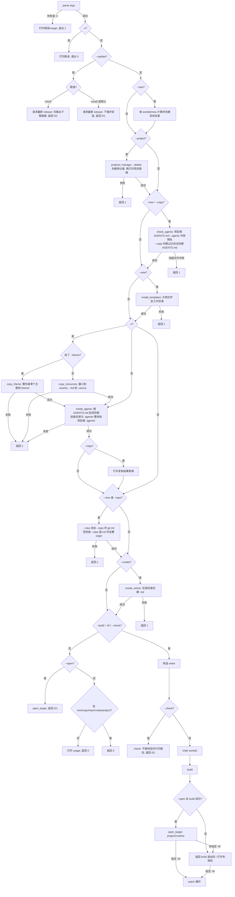

# 2. 命令行接口

入口：`camus/main.cpp:86`，使用 `common/common/cmdline/cmdline.h` 中的 `cmdline::parser` 解析。程序名显示为 `Great writer Camus`。

## 2.1 语法

```bash
camus [选项] [--workdir <目录>]
```

所有选项均为可选；带值选项为 `-w/--workdir`、`--new`、`--create`；`--open`、`--repo`、`--theme`、`--update` 的值可省略（裸 `--open` 等价 `--open project`，裸 `--repo` 等价只执行 `git init`，裸 `--theme` 等价复制整个主题目录，裸 `--update` 等价 `--update install`）。不带任何操作选项直接运行 `camus` 只打印 usage，不触发构建；构建必须显式指定 `--build`（`-W`、`--check` 隐含构建）。

## 2.2 选项表

| 短选项 | 长选项 | 参数 | 说明 | 代码位置 |
|---|---|---|---|---|
| `-h` | `--help` | 无 | 打印帮助并退出（注意退出码为 1） | `main.cpp:90` |
| `-v` | `--version` | 无 | 打印版本、构建信息与 git hash 后退出 0 | `main.cpp:91` |
|  | `--update` | 可选值：`check`（默认 `install`） | 请求最新 release 的 `latest.json`。`install`（裸 `--update` 等价）：有新版本时实时显示进度并下载到系统临时目录，随后打印并执行安装命令（macOS `installer -pkg <file> -target CurrentUserHomeDirectory` 加 `sudo ln -sf <运行期目录>/bin/camus /usr/local/bin/camus`；Linux `.deb`/`.rpm` 分别用 `sudo dpkg -i`/`sudo rpm -Uvh`）；`check`：仅输出下载链接（`curl -LO <地址>`），不下载、不安装。已是最新或执行成功返回 0，请求/下载/安装失败 1；取值非法时打印错误并返回 1 | `main.cpp`、`update.cpp` |
| `-b` | `--build` | 无 | 构建站点；不指定时默认不构建 | `main.cpp` |
| `-c` | `--copy` | 无 | 把精简资源复制到 `<workdir>/assets`（创建 `assets/css`、`assets/js`、空 `assets/fonts` 并复制 `style.css`、`camus.js`）；工作目录已存在 `src/` 或 `posts/` 时不再注入示例 `posts/`；同时把 AI 技能安装到项目根（短入口 `AGENTS.md` 与技能库 `.agents/`，见 §11）；若项目根已存在 `AGENTS.md` 则跳过该文件并打印错误（不覆盖用户文件，`--force` 才覆盖），其余复制继续；完成后打印复制结果表格（见 §8.2.5）；不触发构建，除非同时指定 `--build` | `main.cpp` |
|  | `--theme` | 可选值：主题名 | 仅与 `--copy` 搭配：无值时复制整个 `theme/`，有值时只复制 `theme/<name>/` 到 `<workdir>/theme`；同时复制最小 assets（`style.css`、`camus.js`）并创建空 `fonts/`，不补齐示例文件，也不执行 `--full` | `main.cpp` |
|  | `--full` | 无 | 与 `--copy` 搭配时复制平台数据目录的完整资源树到 `.camus` | `main.cpp` |
| `-f` | `--force` | 无 | `--copy` 时覆盖目标（`assets` 或 `--full` 的 `.camus`）中已存在的同名资源；安装 AI 技能时覆盖项目根 `AGENTS.md` 与 `.agents/` 中内容不同的文件（见 §11.4.2） | `main.cpp` |
| `-d` | `--debug` | 无 | 开启调试日志 | `main.cpp:11` |
| `-W` | `--watch` | 无 | 监听文件变化并自动重建，同时启动本地服务与控制面板（隐含 `--build`） | `main.cpp:11` |
| `-D` | `--dryrun` | 无 | 干跑：不写任何输出文件 | `main.cpp:12` |
| `-C` | `--check` | 无 | 校验配置、资源与 PDF 设置，并执行一次干跑构建后以表格输出检查报告（汇总 / 渲染后的目录结构与文章（含相对 URL）/ Front Matter / Fixes / Issues）；不写文件 | `main.cpp` |
|  | `--fix` | 无 | 仅配合 `--check`：自动补全文章缺失的 `title` / `create-time`（时间取文件创建时间，macOS 为 birth time，其它平台回退修改时间），并创建缺失的 `SUMMARY.md`；不改动格式错误（`(invalid)`）的文件；在 `Fixes:` 区块打印修复记录。`--fix` 未搭配 `--check` 时报错返回 1 | `main.cpp`、`writer.cpp` |
|  | `--new` | 目录字符串 | 创建目录（相对 `--workdir` 或绝对路径），从平台数据目录安装示例文件（`camus.yaml`、`posts`、`.gitignore`、`Justfile`，含 AI 技能安装到项目根 `AGENTS.md` 与 `.agents/`），并自动执行 `--repo`（未显式指定 `--repo` 时只做 `git init`）；不触发构建，除非同时指定 `--build` | `main.cpp` |
| `--create` | 路径字符串 | 在源目录（`src/` 优先，其次 `posts/`）下创建文章：最后一级视为文件名（自动补 `.md`），缺失目录递归创建，并写入模板（`title`（文件名含 `-` 且出现过数字时取最后一个 `-` 之后的片段，否则用文件名）、当前 UTC 时间的 `create-time`，不再自动写入正文标题）；每个新建目录同时生成 `SUMMARY.md`（Front Matter 仅 `title: <目录名>`，目录名同样去除 `01-` 之类的排序前缀，已存在则不覆盖）；文件已存在时不覆盖。不触发构建 | `main.cpp` |
|  | `--repo` | 可选值：远程地址 | 在 `--workdir` 执行 `git init`；提供值时设置 `origin`（已存在则更新），不提供时只 init | `main.cpp` |
|  | `--open` | 可选值：`project`（默认）/`runtime`/`<项目 ID>`/`<项目名>` | 只打开目录，不触发构建：`project` 用 VS Code 打开工作目录（要求工作目录是合法 camus 项目，即含 `camus.yaml`；打开成功后把项目路径与项目名记录到 `<运行期目录>/projects.json`），`runtime` 用系统文件管理器打开运行期目录（安装包写入主题与资源的目录，目录不存在时不会自动创建，直接报错返回 1），`<项目 ID>`（纯数字）或 `<项目名>` 打开已记录项目（数字未命中时报错返回 1）；其它未知值打印 WARN 并按 `project` 处理。与 `--build` 同用时构建成功后再打开 | `main.cpp`、`open.cpp` |
|  | `--project` | 无 | 列出已记录项目的表格（ID / 名称 / 路径），数据来自 `<运行期目录>/projects.json`；不触发构建 | `main.cpp`、`projects.cpp` |
|  | `--delete` | 字符串（ID 或名称） | 仅配合 `--project`：删除对应记录（ID 为纯数字时按 ID 匹配，否则按名称匹配），删除后打印最新表格；未搭配 `--project` 或缺值时打印错误并返回 1 | `main.cpp`、`projects.cpp` |
| `-w` | `--workdir` | 目录字符串，默认 `.` | 工作目录 | `main.cpp:14` |

> 资源来源：主题、默认资源与示例模板由安装包放到平台数据目录。`--new` 安装工作目录根部的示例文件；`-c` 默认只生成最小可编辑资源骨架到工作目录 `assets/`（`css/style.css`、`js/camus.js`、空 `fonts/`），`-c --full` 才复制完整资源到 `.camus`，`-c --theme [name]` 则把主题复制到工作目录 `theme/`。资源查找会依次叠加数据目录、`.camus` 与本地 `./assets` / `theme/`（见 §8）。

## 2.3 解析规则

- 支持组合短选项，例如 `-Cdw /tmp/site`；组合中最后一个带值选项会消费下一个参数。
- 支持长选项 `--name`，带值选项支持 `--name value` 与 `--name=value`。
- 未知长/短选项会被记录为错误；解析失败或存在 `-h` 时，输出 `error_full()` + `usage()` 并返回 **1**。
- 非选项位置参数被收集到 `rest()`，当前主程序**未使用**。
- 解析成功后，`-d` 或编译期 `WORK_ON_DEBUG=true`（Debug/RelWithDebInfo 构建）会把日志级别设为 DEBUG。
- `--open` / `--repo` / `--new` / `--theme` / `--update` 的值处理：解析前会把裸 `--open` 归一化为 `--open=project`、裸 `--repo` 归一化为 `--repo=`、裸 `--theme` 归一化为 `--theme=`、裸 `--update` 归一化为 `--update=install`；若下一参数不以 `-` 开头（如 `--open runtime`、`--repo <url>`、`--new mysite`、`--update check`），则作为其值消费。`--name=value` 写法直接按值解析。
- `--update` 的取值语义：`check` 只检测并打印下载链接，`install`（含裸写法的默认值）下载并安装；其它取值打印 `option --update: unknown value '<value>' (expected check or install)` 并返回 1。
- `--open` 的值语义：`project` / `runtime` 为保留字（项目名与之一冲突时以保留字为准）；纯数字按已记录项目的 ID 匹配；其余按已记录项目的名称精确匹配；都没有命中时打印 WARN 并回退到 `project`（纯数字未命中视为错误，直接返回 1）。
- `--delete` 必须搭配 `--project`，否则打印 `option --delete requires --project` 并返回 1；`--delete=`（缺值）打印 `option needs value: --delete` 并返回 1。
- `--new` 必须提供非空目录值；`--new=` 或裸 `--new` 会打印 `option needs value: --new` 并退出 1。`--create` 同理，缺值打印 `option needs value: --create` 并退出 1。

## 2.4 模式与执行流程

`main` 根据选项组合执行，核心分支如下（`camus/main.cpp`）：



要点：

- `--update` 独立执行（取值 `check` / `install`，裸写法等价 `install`）：请求 `GIT_REPO/releases/latest/download/latest.json`（`cpp-httplib` + OpenSSL）。该文件由 release 流程生成并作为 release 资产上传，包含 `version`、`tag`、`published_at` 与 `assets`（每项 `name`、`url`）。程序解析 `version` 与当前 `PROJECT_VERSION` 做语义化数值比较；有新版本时按平台选择资产（macOS 优先 `.dmg`/`.pkg`，Linux 优先 `.deb`/`.rpm`，否则取第一个）。`check` 只打印 `curl -LO <url>`（`url` 缺失时按 `tag` + `name` 拼出 release 下载地址），不下载也不安装；`install` 则把资产下载到系统临时目录并实时显示进度（每行以 `<本地时间> [UPDT]` 前缀输出，终端内原地刷新并清空整行，完成时输出 `downloaded:`），完成后先打印安装命令再执行（macOS `installer -pkg <file> -target CurrentUserHomeDirectory && sudo ln -sf <运行期目录>/bin/camus /usr/local/bin/camus`，Linux `.deb`/`.rpm` 用 `sudo dpkg -i`/`sudo rpm -Uvh`），成功后删除临时文件；自动安装不支持的文件类型会保留下载文件并返回 1。执行时会打印请求 URL 与当前版本、HTTP 状态；失败（网络错误、非 200、无法解析、下载/安装失败）时打印错误原因、URL，并在有响应体时输出响应内容，返回 1。构建启动时的更新策略由 `auto_check_update` 控制（默认 `auto` = 下载并安装，`check-only` = 仅检测，`disable` = 跳过）；检查 / 下载 / 安装使用 `std::thread` 在后台异步执行，不阻塞本次构建；进程退出时会 join 该线程，若仍在进行则先打印「waiting for background update to finish...」等待提示；`--dryrun` 下跳过。
- 只有指定 `--build`、`-W` 或 `--check` 时才构建。仅执行安装 / 复制 / 建目录 / 创建文章 / `git init` / `--open` 时完成后直接返回 0；完全没有操作时打印 usage 并返回 0（不再默认构建）。
- `--new <dir>` 先把目标解析为「`--workdir` 下的相对路径」或绝对路径并创建，随后安装示例文件：补齐 `camus.yaml`、`posts`（含 `SUMMARY.md`、`posts/private/`）、`.gitignore` 与 `Justfile`。安装完成后自动执行 `git init`（相当于 `--repo`）；若同时显式指定 `--repo`，则按 `--repo` 的远程地址初始化并设置 `origin`。需要构建时另加 `--build`。
- `--create <path>` 在源目录下创建文章：源目录按 `src/` → `posts/` → 默认 `src/` 探测（与构建一致）。路径必须是相对路径且不含 `.` / `..` 段，最后一级为文件名，未以 `.md` 结尾时自动补 `.md`，缺失父目录递归创建；对本次新建的每个目录（不含源目录本身）生成 `SUMMARY.md`，内容为 `---\ntitle: <目录名>\n---`（目录名与文章名使用同一规则：含 `-` 且出现过数字时取最后一个 `-` 之后的片段），已存在的 `SUMMARY.md` 不覆盖；目标文件已存在时打印告警但不覆盖，仍返回 0。新建文章模板为 `---\ntitle: <名称>\ncreate-time: <UTC 时间>\n---\n`：`<名称>` 取文件名（去扩展名），当名称含 `-` 且包含数字时取最后一个 `-` 之后的部分（用于去掉 `01-` 之类的排序前缀），正文留空、不再写入 `## 标题`。
- `--new` 安装的示例文件包括工作目录根部的 `posts`（含各目录的 `SUMMARY.md` 与空的 `posts/private/`）、`camus.yaml`、`.gitignore`、`Justfile`，同名路径已存在则保持不动；`posts/private/` 每次都会确保存在（该行为与 `--copy` 不同，见 §8.2.2）。
- `-c` / `--new` 先做 AI 技能冲突预检，复制动作完成后再安装：数据目录 `SKILLS/AGENTS.root.md` → `<workdir>/AGENTS.md`（短入口，提示先读 `.agents/AGENTS.md`），`SKILLS/AGENTS.md` → `<workdir>/.agents/AGENTS.md`，`SKILLS/<类型>/…` → `<workdir>/.agents/<类型>/…`（详见 §11.4）。目标已存在且内容与来源一致时按已安装处理（可重复执行）；内容不同且未指定 `-f` 时打印冲突路径并终止复制，返回 1；指定 `-f` 时覆盖。`--copy` 下若 `<workdir>/AGENTS.md` 已存在，则跳过该文件并打印 ERROR（不覆盖用户文件，继续其余复制），指定 `-f` 时才覆盖。
- `-c` 默认最小复制：只创建 `<workdir>/assets/css`、`assets/js`、`assets/fonts`，并从数据目录复制 `style.css`、`camus.js`；`fonts/` 只创建空目录（合并查找，无需复制内置字体），随后补齐工作目录根部缺失的示例文件。
- `-c` 在补齐根部示例文件时遵循「已有源目录不注入示例文章」：工作目录已存在 `src/` 或 `posts/` 时，跳过 `posts`（也不再创建 `posts/private/`）；其余 `camus.yaml` / `.gitignore` / `Justfile` 仍按缺失补齐。
- `-c --full` 复制完整资源（`theme/`、`assets/`、`posts/`（含各目录的 `SUMMARY.md` 与 `posts/private/`）、`camus.yaml`、`.gitignore`、`Justfile`）到 `.camus`，并按上一条规则补齐工作目录根部缺失的示例文件。
- `-c --theme` 只复制 `theme/` 到 `<workdir>/theme`；`-c --theme pixel` 只复制 `theme/pixel/`；同时复制最小 assets（`style.css`、`camus.js`）并创建空 `fonts/`，不补齐示例文件，且优先于 `--full`。`--theme` 未搭配 `-c` 时打印错误并返回 1。
- `-f` 仅在 `-c` 时生效：最小复制时覆盖已存在的 `style.css` / `camus.js`；完整复制时先清空 `<workdir>/.camus`（受 §6.1 文件数保护）再重新复制，工作目录已有文件不会被覆盖；`--theme` 时覆盖工作目录 `theme/` 与 `assets/` 中已存在的同名文件，否则跳过。
- `-c` 成功后按 `Item / Result / Target` 三列打印复制结果表格；`Item` 只到目录级别（技能按 `.agents/<类型>` 聚合，不列出其中的文件），`Result` 按状态着色，`Target` 显示相对 `<workdir>` 的目录；覆盖 AI 技能、assets、示例文件与主题的每个条目；`--new` 不打印该表格。列与状态取值见 §8.2.5。
- `--repo` 在 `--workdir` 执行 `git -C <workdir> init -q`；提供远程地址时进一步执行 `git remote get-url origin`，已存在则 `remote set-url origin`，否则 `remote add origin`。无远程地址时只初始化。失败返回 1。
- `--check` 在构建前执行：内部把 dryrun 置为 true，重新加载配置并执行一次干跑构建，然后输出表格报告（`Check:` 汇总、`Output:` 渲染后的目录结构与文章（含相对 URL）、`Front Matter:` / `Fixes:` / `Issues:` 问题表）；不写文件，结果以退出码 0（OK）/1（FAILED）表示（详见 §3.9）。
- `-W` 时即使首次 `build()` 返回非 0，也会进入 `watch()` 循环继续等待变化。
- `-W` 会在页面右下角注入闪电悬浮控制面板（查看构建状态、立即构建、立即重建 PDF、查看 PDF）；PDF 只在首次构建时自动生成，之后只能由控制面板手动触发（详见 §7）。
- `--open` 单独使用时直接打开目标目录并返回，不构建；与 `--build` 同用时仅在 `build()` 返回 0 后执行，且只执行一次：非 watch 模式在打开后按结果退出，watch 模式先打开再进入监听循环。
- `--open project` 依次尝试 `code <workdir>` 与 macOS 的 `open -a "Visual Studio Code" <workdir>`；打开前校验工作目录是合法 camus 项目（含 `camus.yaml`），否则打印 `open failed: not a camus project` 并返回 1；打开成功后把「项目路径 + 项目名」写入 `<运行期目录>/projects.json`（项目名 = 根目录注册的标题，见 §2.8）。
- `--open runtime` 在 macOS 使用 `open <运行期目录>`，其它平台使用 `xdg-open <运行期目录>`；运行期目录是安装包写入主题与资源的目录（`paths::runtime_dir()`，见 §8.1），**不会自动创建**：目录不存在时打印 `open runtime failed: runtime directory not found` 并返回 1。打开失败打印错误并返回 1（watch 模式不退出）。
- `--open <ID>` / `--open <项目名>` 打开已记录项目：先按 ID（纯数字）或名称精确匹配 `<运行期目录>/projects.json`，未命中时纯数字按错误处理（返回 1），其它值回退到 `project`；命中后校验目录存在且仍是合法 camus 项目，打开成功并刷新记录中的项目名。
- `--project` 打印已记录项目表格（列：ID / 名称 / 路径，ID 与名称按显示宽度对齐）；记录为空时打印 `No project recorded.`。`--delete <ID|名称>` 先删除对应记录再打印表格；目标不存在或清单写入失败时打印错误并返回 1。

## 2.5 版本输出

签名/格式（`camus/main.cpp:109-114`）：

```text
v{PROJECT_VERSION} {BUILD_TYPE} with CMake {CMAKE_VERSION} and C++ {CXX_STANDARD}
Build Time: {BUILD_TIMESTAMP} hash={GIT_COMMIT_HASH}
```

示例（版本号以 `CMakeLists.txt` 为准）：

```text
v{PROJECT_VERSION} Release with CMake 3.28.3 and C++ 23
Build Time: 2025-07-24 15:44:00 hash=<40 位 git hash>
```

持久性：仅打印，不写文件。

## 2.6 退出码

| 场景 | 退出码 | 来源 |
|---|---|---|
| 正常构建完成 | 0 | `build()` 返回 0 |
| 版本输出 | 0 | `main.cpp:115` |
| 帮助 | 1 | `main.cpp:102` |
| 参数解析失败 | 1 | `main.cpp:102` |
| 无文章（目录树为空） | 1 | `writer.cpp:812`（非 watch 模式） |
| 安装/复制失败（数据目录无资源或复制异常） | 1 | `install_templates` / `copy_resources` 返回 1 |
| AI 技能安装冲突（项目根 `.agents/` 中存在内容不同的同名文件；`--new` 下项目根 `AGENTS.md` 冲突同此） | 1 | `check_agents` / `install_agents` 返回 1 |
| `git init` / remote 设置失败 | 1 | `init_repository` 返回 1 |
| `--check` 发现错误 | 1 | `writer::check()` 返回 1 |
| `--open` 打开失败 / 目标不是合法 camus 项目 / 项目 ID 不存在 | 1 | `open_target` 返回 1（仅非 watch 模式退出） |
| `--project --delete` 目标不存在或清单写入失败 | 1 | `projects::manage` 返回 1 |
| `--delete` 未搭配 `--project` 或缺值 | 1 | `main.cpp` 参数校验 |
| 致命错误（配置缺失、渲染失败、输出目录文件过多等） | 127 | `logging::fatal` → `std::exit(127)` |
| 未捕获异常 | 127 | catch 中 `logging::fatal` 退出 |

## 2.7 常用示例

```bash
camus --new mysite --build  # 新建 mysite、安装示例配置/文章并构建
camus -cw mysite --build    # 复制最小资源骨架到 mysite/assets 并构建
camus -cfw mysite           # 覆盖 mysite 中已修改的 AGENTS.md 与 .agents/ 技能文件
camus -c --full -w mysite --build  # 复制完整资源到 mysite/.camus 并构建
camus -cf --full -w mysite --build # 强制重装完整资源到 mysite/.camus 并构建
camus -c --theme -w mysite          # 只复制整个 theme 到 mysite/theme
camus -c --theme pixel -w mysite    # 只复制 theme/pixel 到 mysite/theme/pixel
camus -cf --theme pixel -w mysite   # 强制覆盖已存在的 pixel 主题文件
camus -w mysite --build   # 构建 mysite
camus -Ww mysite          # 监听 mysite 并自动重建（隐含构建）
camus --check             # 校验配置、资源与 PDF 设置，并输出产物/当前内容表格
camus --create notes/idea # 在源目录创建 notes/idea.md（自动建目录并生成 notes/SUMMARY.md）
camus --new mysite        # 创建 mysite、安装示例文件并 git init（不构建）
camus --new mysite --repo git@github.com:user/site.git  # 创建、初始化仓库并设置 origin（不构建）
camus --repo              # 在当前工作目录 git init
camus --repo git@github.com:user/site.git               # git init 并设置 origin
camus -D -v               # 版本信息（-D 对 -v 无影响）
camus -dw /tmp/site --build # 调试日志 + 构建
camus --open              # 在 VS Code 打开工作目录（不构建）
camus --open runtime      # 用文件管理器打开运行期目录（安装包写入主题的目录，不构建）
camus --project           # 列出已记录的项目（ID / 名称 / 路径）
camus --project --delete 1        # 删除 ID 为 1 的记录
camus --project --delete "My Site" # 按名称删除记录
camus --open 1             # 在 VS Code 打开 ID 为 1 的已记录项目
camus --open "My Site"     # 在 VS Code 打开名称为 My Site 的已记录项目
camus --update             # 检查并安装最新 release（有新版本时下载并执行安装命令）
camus --update check       # 只检查最新 release 并输出下载链接（不下载、不安装）
```

## 2.8 项目记录（`projects.json`）

实现：`camus/src/projects.h`、`camus/src/projects.cpp`。

- 位置：`<运行期目录>/projects.json`，常量 `CAMUS_PROJECTS_FILE`（`config.h.in`）。运行期目录是安装包写入主题与资源的目录（`paths::runtime_dir()`，见 §8.1）：macOS 安装包只装到当前用户域 `~/Library/Application Support/Camus`，Linux 为 `/var/lib/camus`；旧版系统域安装的 `/Library/Application Support/Camus` 仅作为只读回退。该目录不可写时（例如旧版系统级安装）回退到平台默认数据目录，并打印 WARN 说明实际存放位置。
- 结构：

```json
{
    "projects": [
        {
            "id": 1,
            "name": "Musicals",
            "path": "/Users/alex/Projects/Alex/camus/example"
        }
    ]
}
```

| 字段 | 含义 |
|---|---|
| `id` | 自增 ID，从 1 开始；记录后保持不变，删除其它条目不会改变已有 ID |
| `name` | 项目名 = 根目录注册的标题 |
| `path` | 项目绝对路径 |

- 项目名（根目录注册的标题）解析顺序：源目录（`src` 优先，其次 `posts`）根部的 `SUMMARY.md` 标题（Front Matter `title`，缺省回退正文首个一级标题）→ `camus.yaml` 的 `site.title`（默认值 `A mysterious site` 视为未设置）→ 目录名。
- 写入时机：`--open` 打开成功后写入；同一路径只保留一条记录（更新名称）；按 ID / 名称打开已记录项目时刷新名称。
- 合法性判定：目录存在且包含 `camus.yaml` 即视为合法 camus 项目；不合法时 `--open` 打印错误并返回 1。
- 持久性：清单文件持久于磁盘，进程重启后仍可列出；文件不存在或内容非法时视为空清单（读取失败打印错误）。
