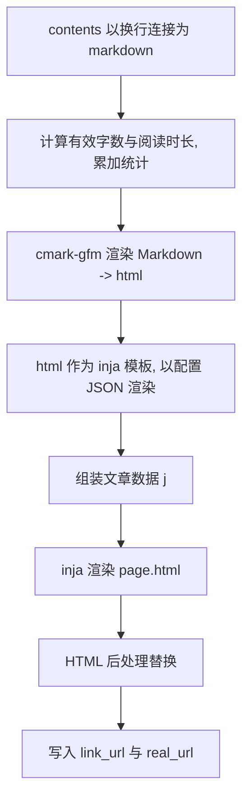

# 5. 模板与渲染

实现：`common/common/render/render.cpp`、`camus/src/writer.cpp`、`camus/src/yaml_config.cpp`。

## 5.1 主题解析

主题由四个模板组成，类型枚举 `camus_theme_type`（`yaml_config.h:51`）：

| 类型 | 文件 | 用途 |
|---|---|---|
| `CAMUS_THEME_TYPE_HOME` | `home.html` | 目录索引页 |
| `CAMUS_THEME_TYPE_PAGE` | `page.html` | 文章页 |
| `CAMUS_THEME_TYPE_STATS` | `stats.html` | 统计页 |
| `CAMUS_THEME_TYPE_FRIENDS` | `friends.html` | 友链页 |
| `CAMUS_THEME_TYPE_SEARCH` | `search.html` | 搜索页（可选；仅 tomato / pixel 提供） |

`search.html` 为可选主题类型：主题目录存在该文件时才生成搜索页与索引，缺失时跳过（不会 fatal）。构建时若有搜索页，会把所有 `visibility != hidden` 的文章打包为文件名不显眼的索引文件（`CAMUS_SEARCH_INDEX_NAME`，当前为 `9f3a7c1e.bin`，模板通过 `build.search_url` 注入 `window.CAMUS_SEARCH_URL`）：内容为 `标题\t链接\t时间\t标签\t正文` 的逐行文本（时间为 `YYYY-MM-DD`，标签以逗号分隔，制表符/换行已替换为空格），先 gzip 压缩再对每个字节 XOR `0x5A`，避免下载后直接按普通 gzip 解出整站文本。运行时 `assets/js/search.js` 读取 `window.CAMUS_SEARCH_URL` 指向的索引文件，XOR 还原后用 `DecompressionStream("gzip")` 解压，按 `indexOf`（默认）或用户开启的正则表达式（`RegExp(..., "i")`）匹配标题与正文，最多渲染 100 条结果链接；每条结果第一行为标题链接，第二行显示发布时间与标签列表（`search-result-meta`），不再显示 URL。搜索关键词与正则开关会实时同步到 URL 的 `q` 与 `re=1` 查询参数（`history.replaceState`，输入为空 / 关闭正则时移除对应参数），带 `?q=关键词`、`?re=1` 的链接打开后会自动恢复输入内容与正则状态，并在索引加载完成后执行搜索。`tomato` 启用「序号」时，搜索结果标题会带上对应章节序号（`window.CAMUS_CHAPTER_INDEX`，切换序号后即时刷新）。`tomato` 的搜索结果区包在 `.tm-panel`（`.tm-search-panel`，最小高度 240px）内：输入框为空（默认）时显示「Enter keywords to search / 输入关键词开始搜索」空状态，无匹配时显示「No results / 暂无搜索结果」，文案跟随 tomato 当前语言（通过 `window.CAMUS_I18N`，切换语言后重新渲染）；始终渲染空状态而非隐藏结果区；搜索输入框字号略小（`0.9rem`），正则开关为输入框内部最右侧的图标按钮（`assets/icons/regex.svg`，通过 CSS mask 跟随文字颜色，激活时高亮）。搜索页复用完整左侧章节目录与控件，入口使用主题色 SVG 放大镜（`assets/icons/search.svg`，通过 CSS mask 跟随文字颜色）；`pixel` 的搜索页复用像素风格容器，并由 `.cover` 限定内容最大宽度 1100px（移动端按断点收窄内边距）。

加载顺序（`yaml_config.cpp:244-264`）：

1. 若本地存在 `theme/{theme_name}/{type}.html`，优先使用本地覆盖。
2. 否则查找 `.camus/theme/{theme_name}/{type}.html`（`-c --full` 复制）。
3. 仍未找到时在平台数据目录中查找同名文件（macOS `~/Library/Application Support/Camus`，Linux `/var/lib/camus`）。
4. 文件不存在时 `logging::fatal("read theme content failed ...")`，进程退出 127。

`theme_name` 默认 `default`；示例站点使用 `terminal`。HTML 引擎固定为 `default`（inja），不再从配置读取，`theme_name` 也不会再拼接引擎子路径。

所有内置主题（`default`/`document`/`pixel`/`terminal`/`tomato`）都额外引用公共资源入口：

- 样式：`{{ with_prefix("/css/style.css") }}`，对应本地 `assets/css/style.css`
- 脚本：`{{ with_prefix("/js/camus.js") }}`，对应本地 `assets/js/camus.js`

两个文件在默认资源中为空文件；用户可在本地 `./assets` 下提供同名文件覆盖，不存在时构建不会报错。

`camus.js` 运行时通过模板写入的 `<body data-camus-theme="{{ render.theme_name }}">` 自动读取主题名并写入 `window.CAMUS_THEME`，同时生成 tomato 开关配置 `window.CAMUS_TOMATO`：

```js
window.CAMUS_TOMATO = {
  volume:  { enabled: true },
  month:   { enabled: true },
  tag:     { enabled: true },
  language: { enabled: true, default: "en" },
  reverse: { enabled: true, default: false },
  index:   { enabled: true, default: false },
  font: {
    family: '"Noto Serif SC", "Source Han Serif SC", "Songti SC", STSong, Georgia, "Times New Roman", serif',
    size: 14
  }
};
```

- `enabled=false` 时对应按钮直接隐藏（分卷 / 时间 / 标签 / 语言 / 倒序 / 序号均支持）。
- `language.default` 为首次访问的默认语言（`en` / `zh`，默认 `en`）；已有 `localStorage` 记录 `tomato-lang` 优先，语言按钮在白天 / 夜间按钮下方，点击切换中英文并持久化。
- `tomato.js` 通过 `data-i18n` / `data-i18n-title` / `data-i18n-aria-label` / `data-i18n-placeholder` 应用翻译，并暴露 `window.CAMUS_I18N`（`current()` / `t()`）供 `search.js` 等共享脚本使用；切换语言时派发 `tomato-lang-change` 事件。
- `reverse` / `index` 的 `default` 表示无本地记录时是否默认选中；已有 `localStorage` 记录优先。
- `font.family` / `font.size` 为正文默认字体与字号：`font.size` 会限制在 14–40px，且已有 `localStorage` 字号记录优先；`font.family` 写入 CSS 变量 `--tm-font-family`。
- 仅当 `window.CAMUS_THEME === "tomato"` 时 `tomato.js` 才应用这些开关；tomato 模板将 `camus.js` 放在 `tomato.js` 之前加载。

`pixel` 主题在 `assets/css/pixel-inja.css` 中设置 `html { font-size: 85%; }`，字体与基于 rem 的元素尺寸整体约缩小 15%。`pixel` 主题的页脚链接（`build.powered_by`）在「Friends」右侧额外提供「Search」入口，其余主题不显示搜索入口；首页/目录页的 `▶ INDEX ◀` 标题行最右侧另有一个仅作展示的假搜索框（`.toc-search`，`SEARCH...` 占位，用 `<a>` 实现、不可输入），点击直接跳转 `search.html`。

`document` / `pixel` / `terminal` / `tomato` 的正文样式区分行内代码与围栏代码块：`pre` 内的 `code` 不再套用行内代码的边框、底色与内边距，代码块边框只由 `pre` 提供。四个主题均从 CDN 加载 highlight.js 进行语法高亮（`tomato` 同时覆盖首页正文），并在 `assets/js/highlight-init.js` 中把 `language-shell` 统一映射为 bash 语法后调用 `highlightAll()`，因此 `shell` / `ini` 等围栏代码会正常着色。

`tomato` 是小说阅读主题：左侧为章节目录（桌面端可点击折叠，移动端默认隐藏并以遮罩抽屉展开），右侧为正文；目录收起 / 展开按钮（`#tm-menu`，`.tm-menu-btn`）在桌面端固定于目录右缘上方（折叠后回落到左上角），移动端（`max-width: 900px`）固定在屏幕右上角；上一章 / 下一章仅显示按钮文案，并按章节目录的更新时间降序（最新在前）取相邻文章（`nav.chapter_prev_*` / `nav.chapter_next_*`），与侧栏目录顺序一致。侧栏底部「友链」右侧提供「搜索」入口，目录栏「序号」右侧提供放大镜按钮，均跳转独立搜索页（`search.html`）；目录支持按分卷筛选（`分卷` 下拉，含「全部分卷」「无分卷」与各不重复分卷；下拉菜单默认宽 200px、最高 400px、右对齐且菜单项行高紧凑）、按时间筛选（`时间` 下拉，按文章 `write_time` 的 UTC 月份分组，已存在的月份显示为 `YYYY-MM`，含「全部时间」；每个时间项的右侧显示文章数量（含全部时间总数），与分卷筛选可叠加）、按标签筛选（`标签` 下拉，列出全部标签并按文章数降序、同数按名称升序，含「全部标签」；每项右侧显示文章数量，可与分卷 / 时间筛选叠加）、倒序（`倒序`）与数字序号（`序号`，右对齐，数字后带 `.`；列宽至少两位数字，并随全书章节数增长），分卷 / 时间 / 标签已选中筛选值以及倒序 / 序号启用时，按钮均使用主题色高亮，分卷标题在目录中以单独一行的小标题展示；章节名过长时单行省略（`...`），副标题与章节名在内容被截断时，悬浮/聚焦会通过主题自绘的深色提示框（非系统原生 `title`）显示完整文本。提供字号调节（默认 `14px`，范围 `14–40px`）、主题模式（自动 / 白天 / 夜间，自动模式跟随系统深浅色）与中英文切换（默认英文，语言按钮位于白天 / 夜间按钮下方），均通过 `localStorage` 持久化并在下次访问时自动恢复（键 `tomato-font-size`、`tomato-theme`（`auto` / `light` / `dark`）、`tomato-lang`（`en` / `zh`）、`tomato-reverse`、`tomato-index`、`tomato-sidebar-collapsed`（桌面端目录折叠，`1` / `0`；移动端目录仍默认隐藏））。当分卷 / 时间 / 标签三个筛选**同时启用且都有数据**时，三个下拉收拢为单个 `Filter` 按钮（`#tm-filter-btn`，i18n `filter.button`），点击展开为**二级级联下拉**（`#tm-filter-menu`）：左侧一级分类（Volumes / Time / Tags，对应 `filter.volume` / `filter.month` / `filter.tag`），右侧显示当前分类的二级选项（分卷含「全部 / 无分卷」、时间 / 标签项带数量），选择后应用筛选、关闭菜单并让 Filter 按钮高亮；级联菜单固定高度 200px（切换分类不改变高度），左下角另有一键清空图标按钮（`assets/icons/filter-clear.svg`，i18n `filter.clear`），点击清空全部分卷 / 时间 / 标签筛选（无任何筛选时按钮置灰）。任一筛选未启用或无数据时仍分别显示原单独下拉。当根路由设置了非空 `logo`（未设置时回退 `cover`，兼容旧键 `cover_image`）时，目录顶部标题区分为左右两栏：标题区默认由内容与封面共同撑开，最高限制为 150px（`max-height`，含内边距）；左侧封面始终 70px 宽并按原图比例展示（不拉伸高度），且不会因标题/简介为空而被裁切；封面（LOGO）本身是链接，点击返回站点首页（`path_prefix` 根路径）；右侧显示标题与副标题，副标题超出可用高度时自动省略（`...`）。未设置封面时保持单栏。封面地址支持绝对 URL 原样使用，相对路径会去除 `assets/` 前缀并按输出根目录拼上 `path_prefix`（`assets/` 内容构建时提升到输出根目录），加载失败时回退为单栏。页面数据使用文章页的 `chapters` 扁平章节列表；目录页（首页）使用 `lead` 直接展示目录子树的第一篇文章正文（含上一章/下一章），侧栏使用 `chapters` 渲染与文章页一致的目录（分卷/倒序/序号），结构与文章页相同；统计页与友链页的侧栏也使用同一 `chapters` 列表与控件，保持目录完整、可用；侧边栏底部右侧显示 `v{{ build.version }}` 版本链接（`<a>`），新窗口跳转该版本的 GitHub Release 页面（`{git.repo}/releases/tag/v{version}`），悬浮提示（`title`）显示完整纯文本 `build.powered_by_text`。正文表格使用低饱和度主题色配色：表头为暗调番茄色（亮色 `--tm-table-head-bg: #ad5642`、暗色 `#8a4d3f`）底，亮色主题下白字、暗色主题下浅色字；边框与奇偶行条纹使用同色系但降低饱和度的独立变量（`--tm-table-border`、`--tm-table-stripe`），不再直接取高饱和强调色，避免白天 / 夜间过亮。文章页与目录页（首页）的 Meta 信息行在末尾展示文章标签（`tags` / `lead.tags`，多个标签以 ` · ` 分隔），并提供「复制链接」按钮（无额外样式，随 Meta 文本），点击复制当前页面 URL（优先 `navigator.clipboard`，不可用时回退 `execCommand`），成功后按钮短暂显示「已复制」。根目录（`/`）页面 `<title>` 固定为 `首页 | 主标题`（`site.title`），子目录页面仍为 `目录名 - 主标题`。样式位于 `assets/css/tomato.css`，交互位于 `assets/js/tomato.js`。

## 5.2 Markdown 渲染

`render_markdown(html, engine, opt)`（`render.cpp`）：

- 仅支持 `engine == "cmark-gfm"`；其它引擎 `logging::fatal("unsupported engine type ...")`。
- 使用 cmark-gfm 解析器 API（`cmark_parser_new` / `feed` / `finish` / `cmark_render_html`），失败返回空串。
- 固定注册并启用常用 GFM 扩展：`table`（表格）、`strikethrough`（删除线）、`autolink`（自动链接）、`tasklist`（任务列表）；因此 HTML 与 PDF 均支持这些语法。
- 选项位由顶层 `html.build` 映射（见 §3.4），Debug/RelWithDebInfo 构建默认带 `CMARK_OPT_SOURCEPOS`；启用表格后 `TABLE_PREFER_STYLE_ATTRIBUTES` 生效（输出 `style="text-align: ..."` 而非 `align`）。

## 5.3 文章渲染流程

`render_single_article()`（`writer.cpp:317`）：



- **Markdown 内联模板**：Markdown 渲染后的 HTML 会再用配置 JSON 做一次 inja 渲染，因此正文中可使用 `{{ build.version }}` 等配置变量（注意与 Markdown 语法/花括号冲突时的转义需求）。
- `display_name` 也会先经 inja 渲染，再清洗 `/`、`\`、`'`、`"` 为空格（§4.5）。

## 5.4 inja 自定义函数

在 `writer` 构造时注册（`writer.cpp:661-689`），可在任意主题模板/正文中使用：

| 函数 | 签名 | 行为 | 示例 |
|---|---|---|---|
| `format_datetime` | `format_datetime(unix_ts)` → string | UTC `%Y-%m-%d %H:%M:%S` | `{{ format_datetime(page.write_time) }}` |
| `format_date` | `format_date(unix_ts)` → string | UTC `%Y-%m-%d` | `{{ format_date(page.write_time) }}` |
| `with_prefix` | `with_prefix(path)` → string | `clean_path(path, public_url.path_prefix)` | `{{ with_prefix("index.html") }}` |

## 5.5 文章页渲染数据

`render_single_article` 组装的 JSON `j`（`writer.cpp:359-369`）由配置数据叠加节点数据得到：

| 键 | 结构 | 说明 |
|---|---|---|
| `camus` / `source_dir` / `assets_dir` / `sitemap` / `filename_case` / `public_url` / `protocol` / `domain_name` / `path_prefix` / `render` / `friends` / `site` / `route` / `git` / `build` | 见 §3.7 | 站点配置 |
| `title` | 字符串 | 文章显示名（来自节点 `to_json`） |
| `write_time` | 数字 | 文章时间戳 |
| `path` | 字符串 | 节点 `real_url` 加上 `public_url.path_prefix` 的完整链接（主题直接作 `href`） |
| `is_dir` | bool | 文章为 false |
| `link_path` | 字符串 | 短链路径，无短链时为空 |
| `tags` | 数组 | 文章标签 |
| `toc` | 数组 | 顶级目录/文章项（见 §5.6） |
| `page.title` | 字符串 | 同 `display_name` |
| `page.write_time` | 数字 | 同上 |
| `page.description` | 字符串 | 固定为空串 |
| `page.contents` | 字符串 | 已渲染的正文 HTML |
| `stats.word_count` | 数字 | 有效字数 |
| `stats.read_min` | 数字 | 阅读分钟数（整数；`<1` 时主题显示「小于1分钟」） |
| `nav.next_path` / `nav.next_title` | 字符串 | 下一篇（按更新时间更旧） |
| `nav.prev_path` / `nav.prev_title` | 字符串 | 上一篇（按更新时间更新） |
| `nav.chapter_prev_path` / `nav.chapter_prev_title` | 字符串 | 上一章（按更新时间降序，最新在前） |
| `nav.chapter_next_path` / `nav.chapter_next_title` | 字符串 | 下一章（按更新时间降序，最新在前） |
| `chapters` | 数组 | 全部非 `hidden` 文章的扁平章节列表，按更新时间降序（最新在前，时间相同按源路径升序）；每项含 `title`、`path`、`write_time`、`tags`（标签数组）、`current`（是否为当前文章）、`volume`（所属目录显示名）与 `volume_key`（所属目录路径，用于分组；根目录下的文章均为空串）。供 `tomato` 等阅读主题渲染章节目录与标签筛选 |
| `render_data.stats/page/nav` | 对象 | 节点自带的渲染数据（与顶层 `stats/page/nav` 同源） |

`page.html` 渲染后还会做 HTML 后处理（见 §5.8）。

## 5.6 TOC 数据项

`build_toc_items()` 取根节点直接子节点中 `visibility` 既不是 `hidden` 也不是 `hidden_in_toc` 的项，序列化为 `catalog_node` JSON，并排序（目录优先，再按 `write_time` 降序，时间相同按 `path` 升序）。该数组用于文章页/统计页的导航。

`emit_toc` / `emit_friends` 中会对每个目录页构造：

| 键 | 结构 | 说明 |
|---|---|---|
| `parent.url` | 字符串 | 父目录 `link_url` 加上 `public_url.path_prefix` 的完整链接；根目录为空 |
| `parent.label` | 字符串 | 父目录显示名；父目录为根时固定为 `/` |
| `items` | 数组 | 当前目录直接子节点（过滤 `hidden` 与 `hidden_in_toc`；目录优先，再按时间降序、`path` 升序） |
| `current` | 对象 | 当前目录节点 JSON（含 `render_data`）；其中 `current.path` 被覆盖为相对目录树路径（根为 `/`） |
| `lead` | 对象 | 当前目录子树中按路径升序的第一篇非 `hidden` 文章（无则不存在）：`title`、`path`、`write_time`、`contents`（已渲染正文 HTML）、`word_count`、`read_min`（整数）、`tags`（数组）、`nav`（上一章/下一章）；目录页由 `tomato` 用于直接展示正文 |
| `chapters` | 数组 | 与文章页相同的扁平章节列表（含 `tags` / `volume` / `volume_key`）；`tomato` 的目录页侧栏据此渲染分卷、时间、标签、倒序、序号等，并把 `lead` 标记为当前章节 |
| 其余键 | — | `conf_.json()` 的顶层键（`camus/source_dir/assets_dir/sitemap/filename_case/public_url/protocol/domain_name/path_prefix/render/friends/site/route/git/build`）被合并进来 |


注意：这些目录页数据是「父级 + 子项 + 当前目录」结构，不是完整递归树。

## 5.7 统计页与友链页数据

- 统计页：`{ ...conf, toc, stats, chapters }`，其中 `stats` 为对象：
  - `all`：全站聚合；
  - 数字键（如 `"2025"`）：按年份聚合。
  - 每项字段：`articles`、`words`、`read_mins`、`min_time`、`max_time`、`tags`（数组）。
  - `chapters` 与文章页相同（见 §5.6），供侧栏渲染完整章节目录。
  - `stats_overview`：顶部概览卡片数据，含 `words`（总字数）、`articles`（文章数）、`days`（首篇到最新一篇的跨度天数，空站为 0）、`read_mins`（总阅读分钟数）。
- 友链页：`{ ...conf, toc, friends, chapters }`，`friends` 为 §3.6 的数组，`chapters` 同上。

## 5.8 HTML 后处理

文章页最终 HTML 会执行一组替换（`strings::replace(..., map, deep=true)`）：

| 查找 | 替换 |
|---|---|
| ` 00:00:00` | 空串 |
| ``）会被保留。

## 5.9 渲染错误处理

- 模板 inja 渲染异常：打印出错行号附近内容（`strings::mark_string`）后 `logging::fatal`，退出 127。
- Markdown 引擎缺失/不支持：`logging::fatal` 退出 127。
- 主题文件缺失：`logging::fatal` 退出 127。
- 文章 `link_url` 为空：`logging::fatal("make article failed ...")`。

持久性：渲染结果仅写入输出目录，可随时重建；无运行期缓存（除数据目录中的主题文件与内存队列）。

## 5.10 PDF 模板与样式

PDF 的 HTML 模板与打印样式不再硬编码在 `writer.cpp`，而是作为独立资源放在 `theme/pdf/`（常量 `CAMUS_PDF_THEME_DIR`，`config.h.in`）：

| 文件/目录 | 常量 | 作用 |
|---|---|---|
| `theme/pdf/page.html` | `CAMUS_PDF_TEMPLATE_NAME` | 完整 PDF 中间 HTML 文档模板（inja） |
| `theme/pdf/style.css` | `CAMUS_PDF_STYLE_NAME` | 打印样式，由模板通过 `{{ pdf.style }}` 内联到 `<style>` |
| `theme/pdf/fonts.css` | `CAMUS_PDF_FONTS_NAME` | 字体样式（`@font-face` 与 `body` 的 `font-family`），通过 `{{ pdf.fonts }}` 内联 |
| `assets/fonts/` | `CAMUS_PDF_FONTS_DIR` | 站点与 PDF 共用的字体目录；构建时复制到 `dist/pdf/assets/fonts/`，供 `fonts.css` 以 `assets/fonts/...` 引用 |

加载顺序（`writer::emit_pdf()` → `read_pdf_theme_file()`，`writer.cpp`）：

1. 工作目录 `theme/pdf/<file>`（显式本地覆盖）。
2. `paths::find_resource("theme/pdf/<file>")`：先 `.camus/theme/pdf/<file>`（`-c --full` 复制），再平台数据目录。
3. `page.html` / `style.css` 均不存在时 `logging::fatal("read pdf theme content failed name=...")`，退出 127；`fonts.css` 可选，缺失时 `pdf.fonts` 为空串并继续生成。

`page.html` 使用 inja 渲染，上下文为 §3.7 的配置 JSON 加上 `pdf` 对象：

| 键 | 类型 | 说明 |
|---|---|---|
| `pdf.lang` | 字符串 | 站点标题非空时为 `zh-CN`，否则为 `en` |
| `pdf.title` | 字符串 | 已 HTML 转义的封面标题（站点标题为空时回退 `Camus`） |
| `pdf.style` | 字符串 | `style.css` 经配置 JSON 渲染后的内容，末尾追加由 `pdf.page` 生成的 `:root { --pdf-font-size }`、`@page { size; margin }` 与 `@page cover { size; margin: 0 }` 覆盖规则（可写 inja 配置变量；另提供顶层 `pdf_page_offset` 供页码偏移使用） |
| `pdf.page` | 对象 | `size`、`margin`、`font_size`，来自配置 `pdf.page`；默认 `A4` / `20mm 18mm` / `10pt`，空值回退默认，`font_size` 非 pt 或非法时回退 `10pt` |
| `pdf.fonts` | 字符串 | `fonts.css` 经配置 JSON 渲染后的内容；文件缺失时为空串 |
| `pdf.asset_style` | 布尔 | 站点输出 `css/style.css` 是否存在并成功复制为 `dist/pdf/assets.css`；默认模板为真时在 `<style>` 前输出 `<link rel="stylesheet" href="assets.css">`，保证 PDF 主题样式优先 |
| `pdf.cover` | 对象 | `eyebrow`、`title`、`subtitle`、`description`、`meta`（生成日期）、`image`（根 `SUMMARY.md` 的 `cover` 指向有效文件时为其复制后的文件名，否则空串）、`has_image`（是否存在有效封面图；空串在 inja 中为真值，模板须用该布尔值判断）；标题等字段按模板需要预转义；默认模板优先输出整页封面图，无图时输出 `title`、`subtitle` |
| `pdf.title_page` | 对象 | `title`、`subtitle`、`description`（`site.description`），均按模板需要预转义 |
| `pdf.meta` | 对象 | `article_count`、`generated_at`、`domain`、`has_domain`（域名是否为空）、`version`；默认模板不显示 `article_count`，且 `has_domain` 为假时不输出站点行 |
| `pdf.labels` | 对象 | 预定义名称的本地化文案：`cover`（封面）、`contents`（目录）、`site`（站点）、`generated`（生成时间）、`compiler`（编译器）。根据合并后 Markdown 的中文占比选择中文或英文，供扉页、TOC 标题与 PDF 书签大纲使用 |
| `pdf.toc` | 数组 | 按真实目录树输出，同层顺序由 `pdf.sort` 决定（见 §3.3.1）。每项含 `anchor`、`index`、`number`（两位序号）、`title`（HTML 转义）、`outline_title`（纯文本，供 PDF 书签使用）、`tags`、`page`（1 起始页码；解析不到时为空串）、`page_label`（`{:03}` 三位补零页码；解析不到时为空串）、`depth`（相对根目录的显示层级，根目录下为 0）、`is_dir`。目录节点 `anchor`/`number`/`tags`/`page`/`page_label` 为空，只作分组标题；文章节点 `anchor` 为 `pdf-article-{n}`。`title`/`tags` 已转义 |
| `pdf.articles` | 数组 | 每项 `anchor`、`index`、`number`、`title`、`tags`、`content`；`content` 为渲染后的文章 HTML，**未转义** |

- 默认模板的扉页与目录使用 `pdf.labels` 提供的标签（`site` / `generated` / `compiler` / `contents`），不输出文章数；扉页元信息按 `site → generated → compiler` 顺序排列，`site` 行为空（`pdf.meta.has_domain` 为假）时整行省略；`compiler` 行显示 `Camus v{version}` 并链接到对应 GitHub release。
- **预定义名称语言**：`emit_pdf()` 在合并 Markdown 后调用 `chinese_ratio()`（按 UTF-8 解码为码点，统计 CJK 汉字与中文标点、ASCII 字母数量），中文占比 `> 50%` 时 `pdf.labels` 使用中文（封面 / 目录 / 站点 / 生成时间 / 编译器），否则使用英文（Cover / Contents / Site / Generated / Compiler）。默认模板的标题页、目录标题与 `pdf::write_outline()` 注入的书签大纲均使用该标签；自定义模板可读取 `pdf.labels` 保持一致。
- 页码从正文第一篇文章开始计为第 1 页（不再生成独立的引导页）：封面使用命名页 `page: cover`（四边 0 边距、整页铺满复制后的封面图），扉页、目录使用命名页 `page: front`，其 `@bottom-center` 内容为空；`html { font-size: var(--pdf-font-size); counter-reset: page {{ pdf_page_offset }}; }` 整体偏移页计数。默认模板在 `<body>` 顶部放置 `display: none` 的 `#pdf-cover`、`#pdf-toc` 链接，使浏览器在 PDF 中生成这些锚点的命名目标（分别对应封面、目录页）。
- 默认 `style.css` 通过 `@page { @bottom-center { content: counter(page, camus-page); color: #000; } }` 在正文页底部居中输出黑色页码。Chrome 不支持 `@counter-style` 的 `pad` 描述符，因此第二遍渲染前会由 `pdf::page_count()` 读取总页数，并追加一个 `@counter-style camus-page { system: fixed; first: 0; symbols: "001" "002" ... }` 覆盖样式，使页脚与目录页码统一为三位补零（页脚与 `pdf.toc[].page_label` 均从正文第 1 页起算，使用同一套正文页序）。
- 默认目录模板按 `pdf.toc[].depth` 缩进渲染多级目录：目录节点输出分组标题，文章节点输出标题与 `page_label`（三位补零页码）；不输出序号（`number`）与标签（`tags`），条目之间不画虚线下划线。最终 PDF 另由 `pdf::write_outline()` 按同一 `pdf.toc` 注入可交互书签大纲。
- **两遍渲染**：第一次生成 PDF 后解析其命名目标（anchor → 页对象）得到各锚点物理页码；以目录中第一篇文章（`pdf-article-1`）的物理页计算 `pdf_page_offset = 1 - first_article_page`，回填 `pdf.toc[].page = article_page + pdf_page_offset` 并重新渲染 `pdf.style` 与 HTML，再次打印 PDF。解析失败时保留第一遍产物（目录页码为空、目录锚点仍可跳转）。目录页码列在首遍即占位固定宽度，避免第二遍排版位移。

- `style.css` 与 `fonts.css` 先以配置 JSON 单独渲染（可使用 `{{ build.version }}`、`{{ site.title }}` 等配置变量），再分别作为 `pdf.style` / `pdf.fonts` 字符串插入 `page.html`；`page.html` 自身以「配置 JSON + `pdf` 对象」渲染。插入的样式内容不会被二次解析。第二遍打印前会再以更新后的 `pdf_page_offset` 重新渲染一次 `pdf.style`。
- 站点资源中的 `assets/css/style.css`（构建后位于 `dist/html/css/style.css`）会在 PDF 阶段复制为 `dist/pdf/assets.css`，由默认模板以 `<link>` 引在 PDF 内联样式之前，因此不会覆盖 `theme/pdf/style.css`（PDF 主题规则在后、优先级更高）；文件不存在时 `pdf.asset_style` 为假、不输出该 `<link>`。
- `body` 的字体定义默认位于 `fonts.css`，`style.css` 只保留颜色、行高等打印样式。`fonts.css` 中的自定义字体示例默认被注释：将字体文件放入 `assets/fonts/`，取消 `@font-face` 与 `body` 覆盖注释即可启用。
- 站点资源 `assets/fonts/`（构建后位于 `dist/html/fonts/`）会在写 `dist/pdf/index.html` 前递归复制到 `dist/pdf/assets/fonts/`，因此 `url("assets/fonts/<file>.ttf")` 相对 `dist/pdf/index.html` 可正常加载；目录缺失时跳过复制。
- 默认模板的封面/扉页/目录/文章分页样式保持一致，其中封面为整页满铺图片（来源为根 `SUMMARY.md` 的 `cover`）、扉页字号较封面缩小且内容靠上、内容区占满可用宽度、目录按真实目录树多级缩进；用户可整体替换 `page.html`，或只覆盖 `style.css` / `fonts.css`（字体文件放在站点 `assets/fonts/`）。
- 默认 `style.css` 的所有字号均以 `calc(var(--pdf-font-size) * <比例>)` 表示（页脚、正文、标题、代码、表格、封面、扉页、目录等），根元素 `font-size` 也取该变量，因此修改 `pdf.page.font_size` 会整体等比例缩放，最终排版单位为 `pt`。
- 输出 `dist/pdf/index.html` 是模板渲染结果；`dist/pdf/index.md` 仍由程序生成，不受模板影响。
- 页面写入成功与否只影响 PDF 阶段；`page.html`/`style.css` 缺失属于配置错误，会以致命错误退出（与普通主题缺失一致）。
- 模板/样式/字体源文件持久于工作目录 `theme/pdf`、`.camus` 或数据目录；生成的 `dist/pdf` 产物可随时重建。
