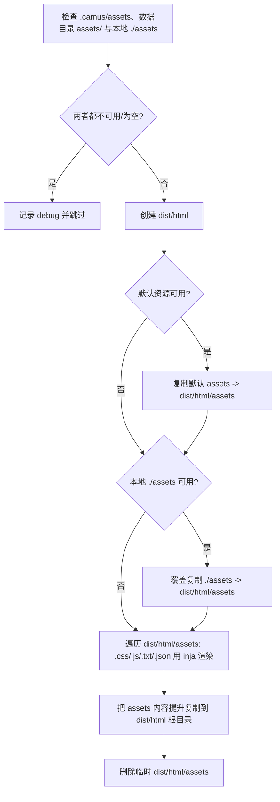

# 6. 输出产物

实现：`writer::build()` 各阶段（`camus/src/writer.cpp`）。输出目录固定：HTML 写入 `./dist/html`，PDF 写入 `./dist/pdf`（不可配置）。

## 6.1 输出目录清理与安全保护

`prepare_output_dir()`（`writer.cpp:220`）在渲染文章前执行：

```text
empty_path(dest_dir(),  safe_check=true, safe_limit=build.safe_clean_limit)   // ./dist/html
empty_path(pdf_dir(),   safe_check=true, safe_limit=build.safe_clean_limit)   // ./dist/pdf
```

`empty_path(path, true, false, safe_limit)`（`filesystem.cpp:157`）规则：

- 路径不存在：直接返回（不创建）。
- 若存在，递归扫描条目数（扫描上限 `max(10000, safe_limit)`）：
  - 条目数 **> `build.safe_clean_limit`**（默认 **300**，`camus.yaml` 可改，亦可用 `CAMUS_BUILD_SAFE_CLEAN_LIMIT` 覆盖）：`logging::fatal("Too many files and need to be deleted manually ...")`，退出 127，**不会删除**；
  - 否则 `remove_all` 清空。
- 因此输出目录条目数超过该阈值时必须人工清理后才能构建。`-C` 预检（`check_output_dir`）使用同一阈值，提前报告 `has N files (>limit); build will abort`。

构建结束后各写入路径会由 `flush_writes()` 通过 `create_directories(parent_path)` 自动创建。

每次构建输出阶段统计日志（info 级别）：

- HTML：构建开始时不输出日志；完成后输出 `html build complete files=<文件数> bytes=<总字节> elapsed=<秒>s output=<输出目录>`。
- PDF：`pdf build started articles=<文章数> engine=<引擎>`；完成后 `pdf build complete articles=<文章数> pages=<页数> bytes=<文件字节> elapsed=<秒>s dest=<PDF 路径>`。
- PDF 未启用、引擎不可用或无文章时不会输出 PDF 阶段日志；`-W` 每次重建按相同规则输出，不改变监听逻辑。

## 6.2 输出文件布局

以示例站点（启用 sitemap / RSS 与 PDF）为例：

```text
dist/
├── html/                           # HTML 站点
│   ├── <文章 real_url>             # 如 dist/html/introduction/M/Mozart!.html
│   ├── s/<short_path>.html         # 启用 short-path 时的短链副本
│   ├── <目录 real_url>/index.html  # 每个目录节点一页（含根目录 dist/html/index.html）
│   ├── stats.html
│   ├── friends.html
│   ├── search.html                 # 主题提供 search.html 时（tomato / pixel）
│   ├── 9f3a7c1e.bin                # 搜索索引（文件名取 CAMUS_SEARCH_INDEX_NAME，XOR + gzip）
│   ├── sitemap.xml                 # build.sitemap=true
│   ├── feed.xml                    # build.rss=true
│   └── <assets 内容提升到根>        # css/ js/ fonts/ robots.txt favicon.ico ...
├── pdf/                            # pdf.engine 非空且不为 disable 时
│   ├── index.md                    # 合并后的 Markdown
│   ├── index.html                  # PDF 中间 HTML
│   ├── index.pdf                   # 最终 PDF（可由 pdf.build 的自定义路径）
│   ├── assets.css                  # 站点 css/style.css 存在时复制（不覆盖 PDF 主题样式）
│   ├── assets/fonts/               # 站点 assets/fonts 复制到 PDF（fonts.css 以 assets/fonts/... 引用）
│   └── cover.<ext>                 # cover 有效时复制/下载为封面（保留原扩展名）
└── cache/                          # PDF 阶段复用缓存（不随构建清理，跨构建保留）
    ├── {engine}_userdata/          # 复用浏览器 profile（HTTP / 代码 / GPU 缓存），默认路径
    └── images/                     # PDF 正文远程图片，按 host + URL 路径保存
        └── <host>/<path>           # 如 https://host/a/b.png -> cache/images/host/a/b.png
```

| 产物 | 触发条件 | 代码位置 |
|---|---|---|
| 文章页 | 每篇 `visibility != hidden` 的 `.md` | `writer.cpp:392-394` |
| 目录索引页 | 每个非空目录节点（含根；空目录在收尾阶段被移除） | `writer.cpp` `emit_toc()` |
| `stats.html` | 始终（除非 dryrun） | `writer.cpp:408` |
| `friends.html` | 始终（除非 dryrun） | `writer.cpp:461` |
| `search.html` / `CAMUS_SEARCH_INDEX_NAME`（`9f3a7c1e.bin`） | 主题存在 `search.html`（tomato / pixel）且非 dryrun | `writer.cpp` `emit_search()` |
| `sitemap.xml` | `build.sitemap: true` | `writer.cpp` `emit_sitemap()` |
| `feed.xml` | `build.rss: true` | `writer.cpp` `emit_feed()` |
| 静态资源 | 数据目录 `assets/` 或本地 `./assets` 非空 | `writer.cpp` `emit_assets()` |
| `index.md` / `index.pdf` / `index.html`（均位于 `dist/pdf`） | `pdf.engine` 非空、不为 `disable` 且引擎可用 | `writer.cpp` `emit_pdf()` |
| `dist/pdf/assets.css` | 站点输出中存在 `css/style.css` | `writer.cpp` `copy_pdf_asset_style()` |
| `dist/pdf/assets/fonts/` | 站点输出中存在 `fonts/`（来自 `assets/fonts/`） | `writer.cpp` `copy_pdf_asset_fonts()` |
| `dist/cache/{engine}_userdata/` | PDF 阶段且未在 `pdf.build` 中自定义 `--user-data-dir` | `writer.cpp` `emit_pdf()` |
| `dist/cache/images/<host>/<path>` | PDF 正文出现 `http(s)` 图片 URL 且本地缓存不存在 | `writer.cpp` `localize_pdf_images()` |

## 6.3 文章输出

- 写入路径为 `out_dir / clean_path(url, "./")`，`out_dir = relative(dest_dir, workdir)`。
- 同时写入 `link_url()` 与 `real_url()`；二者相同时去重。
- `short-path` 启用时，`/s/<short>.html` 与普通文章路径内容相同。
- 同一路径重复入队会 `logging::fatal("output file already queued ...")`。

## 6.4 目录索引页（TOC 页）

`emit_toc()`（`writer.cpp:467`）：

- HTML 引擎固定为 `default`（inja 模板），不再从配置读取。
- 遍历所有目录节点，为每个目录构造 §5.6 的目录页数据，用 `home.html` 渲染。
- 输出路径：`dest_dir/{real_url}/index.html`（根目录为 `dest_dir/index.html`）。
- 注意 `current` 为目录节点，`items` 为其直接子节点；深层目录通过各自的页面表达，不展开为完整递归树。

## 6.5 统计页 `stats.html`

`render_stats_page()`（`writer.cpp:397`）使用 `stats.html` 模板，数据为 `{ ...conf, toc, stats, chapters }`（见 §5.7）。`tomato` 主题的统计页侧栏与文章页一致，使用 `chapters` 渲染完整章节目录及分卷 / 倒序 / 序号控件。

`stats` 对象字段（`article_stats`）：

| 字段 | 类型 | 说明 |
|---|---|---|
| `articles` | 数字 | 文章数 |
| `words` | 数字 | 有效字数合计 |
| `read_mins` | 数字 | 阅读分钟数合计 |
| `min_time` | 数字 | 最早文章时间 |
| `max_time` | 数字 | 最晚文章时间 |
| `tags` | 字符串数组 | 去重后的标签集合 |

`all` 桶的 `min_time` 初始为 `time_t` 最大值；年份桶以 `1996 < 1970 + write_time/(365*86400) < 2200` 过滤，键为年份字符串。

`tomato` 主题的统计页顶部展示 4 张概览卡片：总字数、文章数、总创作天数、总阅读时长，数据来自 `stats_overview`（`words` / `articles` / `days` / `read_mins`）。`days` 为首篇到最新一篇的跨度天数（`(max_time - min_time) / 86400 + 1`），无文章时为 0；`read_mins` 为全站阅读分钟数合计。窄屏（≤900px）时卡片改为两列。

`tomato` 主题的统计页顶部不再展示「篇数 / 字数 / 阅读时长」元信息行，改为「年度趋势」折线图面板：`assets/js/tomato.js` 的 `initStatsChart()` 读取下方年度表格的「年份 / 篇数 / 字数」列，按年份数值升序用 SVG 绘制折线、面积、数据点与坐标轴（无数据时显示「暂无数据」并隐藏图表）。面板右上角提供「文章数量 / 文字数量」切换开关，默认展示文章数量；切换后按对应列重绘，悬浮数据点显示该年的篇数或字数。

## 6.6 友链页 `friends.html`

`emit_friends()` 使用 `friends.html` 模板，数据为 `{ ...conf, toc, friends, chapters }`；`toc` 为根节点直接子节点（过滤 `hidden` 与 `hidden_in_toc`）排序后的数组。输出到 `dest_dir/friends.html`。`tomato` 主题的友链页侧栏同样改用 `chapters` 渲染完整章节目录及分卷 / 倒序 / 序号控件。

`tomato` 主题的友链列表在每项左侧展示 `image_url` LOGO（56×56 圆形、无边框，绝对 URL 原样使用，相对路径去除 `assets/` 前缀后拼接 `path_prefix`，加载失败时移除图片），移除了行间分割线；无 `image_url` 或加载失败时保留 56×56 占位区域，文字始终左对齐。LOGO 与友链标题均可点击跳转，友链链接、LOGO、侧栏章节与底部导航等可交互元素统一使用手型光标。

## 6.7 `sitemap.xml` 与 `feed.xml`

`emit_sitemap()` 在 `build.sitemap` 为 true 时生成：

```xml
<?xml version="1.0" encoding="UTF-8"?>
<urlset xmlns="http://www.sitemaps.org/schemas/sitemap/0.9">
  <url><loc>{full_prefix}{node.link_url}</loc><lastmod>{YYYY-MM-DD}</lastmod></url>
</urlset>
```

- `full_prefix = protocol + domain_name + path_prefix`（来自 public_url）。
- 只包含非目录节点；条目间以换行 + 制表符分隔。
- 使用 `link_url`：启用 `short-path` 时 `<loc>` 为短链地址。
- 包含 `open` 与 `hidden_in_toc` 的文章，不包含 `hidden`。
- 输出为 `dest_dir/sitemap.xml`。

`emit_feed()` 在 `build.rss` 为 true 时生成 `dest_dir/feed.xml`（RSS 2.0）：

```xml
<?xml version="1.0" encoding="UTF-8"?>
<rss version="2.0"><channel>
  <title>{site.title}</title><link>{full_prefix}/</link><description>{site.description}</description>
  <lastBuildDate>{最新文章时间，RFC 822}</lastBuildDate>
  <item><title>{文章标题}</title><link>{full_prefix}{link_url}</link>
    <guid isPermaLink="true">{full_prefix}{link_url}</guid><pubDate>{write_time，RFC 822}</pubDate></item>
</channel></rss>
```

- 包含 `open` 与 `hidden_in_toc` 的文章，不包含 `hidden`；按 `write_time` 降序（相同时间按标题升序）。
- 标题、链接与站点描述做 XML 转义；空站点标题回退 `Camus`，空 `public_url` 时频道链接为 `/`。
- 所有内置主题在 `<head>` 中通过 `` 输出自动发现标签：`<link rel="alternate" type="application/rss+xml" title="{site.title}" href="{path_prefix}/feed.xml">`。

## 6.8 静态资源

`emit_assets()`（`writer.cpp`）：



- 资源按三层叠加：平台数据目录 `assets/`（macOS `~/Library/Application Support/Camus`，Linux `/var/lib/camus`）→ `.camus/assets`（`-c` 最小或完整复制）→ 本地 `./assets`；后层覆盖前层同名文件。
- 本地资源目录固定为 `./assets`；存在且非空时整体覆盖前两层同名文件，不存在或为空时使用前两层。
- 默认最小复制只包含 `css/style.css` 与 `js/camus.js`，其余主题资源仍从平台数据目录加载。
- 默认资源包含空文件 `css/style.css` 与 `js/camus.js`，所有内置主题都会引用它们；本地未覆盖时输出同名空文件，不报错。
- 仅 `.css`、`.js`、`.txt`、`.json` 会做 inja 变量替换，其它文件原样复制。
- 最终资源被**提升到输出根目录**（如 `dist/html/css/...`、`dist/html/robots.txt`），不保留 `assets/` 前缀。

## 6.9 dryrun 的影响

`-D/--dryrun` 下：

| 阶段 | 行为 |
|---|---|
| `prepare_output_dir` | 不清理输出目录 |
| `add_write` | 直接返回，不排队 |
| `flush_writes` | 队列为空，无写入 |
| `emit_toc` | 提前返回（不生成目录页） |
| `emit_assets` | 提前返回 |
| `emit_pdf` | 提前返回 |
| 文章/统计/友链/sitemap/feed | 正常计算并调用 `add_write`，但不落盘 |

因此 dryrun 可用于验证配置与渲染流程而不改变磁盘。

## 6.10 PDF 输出

`emit_pdf()` 在 `flush_writes()` 之后执行，仅在顶层 `pdf.engine` 非空且不为 `disable` 时生效：

```mermaid
flowchart TD
    A[pdf.engine 为空或为 disable] -->|是| Z[跳过]
    A -->|否| B[解析 Chrome/Edge 可执行文件]
    B -->|未找到| W[WARN 并跳过]
    B -->|找到| C[按目录树顺序收集 visibility != hidden 的 .md：同层顺序由 pdf.sort 决定]
    C --> D[合并为单个 Markdown]
    D --> E[写 dist/pdf/index.md]
    E --> F[逐篇 cmark-gfm 渲染为 HTML, 组装 pdf.toc / pdf.articles / 封面等数据]
    F --> IMG[匹配正文远程图片 URL, 下载到 dist/cache/images（已存在则跳过）, src 改写为本地相对路径]
    IMG --> CV[解析根 SUMMARY.md 的 cover（URL 构建前先下载）, 复制为 dist/pdf/cover.<ext>]
    CV --> CA[复制 dist/html/css/style.css -> dist/pdf/assets.css]
    CA --> G[读取 theme/pdf/page.html / style.css / fonts.css, 用 inja 渲染完整文档]
    G --> H[复制 dist/html/fonts -> dist/pdf/assets/fonts, 写 dist/pdf/index.html（内联样式与字体样式）]
    H --> I[调用浏览器 --headless --print-to-pdf=<解析后的输出路径>]
    I --> J{退出码为 0 且 PDF 非空?}
    J -->|否| W2[WARN 并跳过]
    J -->|是| N[解析 PDF 命名目标得到每篇起始物理页码]
    N --> O{解析到页码?}
    O -->|是| P[回填 pdf.toc[].page/page_label, 按总页数生成补零页脚样式, 重新渲染 index.html 并再次打印 PDF]
    O -->|否| K
    P --> K[注入 PDF 书签大纲 /Outlines]
    K --> DONE[完成]
```

- 合并文档以 `# {site.title}` 开头，每篇文章为 `## {display_name}` + 正文，文章间用 `---` 分隔。
- PDF 内文章与目录的排序由 `pdf.sort` 决定（`writer.cpp` `emit_pdf()` 的 `append_node`，见 §3.3.1）：`file_first`（默认）先文件后子目录、`dir_first` 先子目录后文件，两组内部按相对路径字符串字典序升序；`mixed` 完全按路径字典序。该顺序同时决定 PDF 正文、目录页 `pdf.toc` 与书签大纲的排列；与 HTML 站点（TOC 目录优先、按 `write_time` 降序）不同。
- PDF 中间 HTML 由 `theme/pdf/page.html`（inja）渲染，打印样式来自 `theme/pdf/style.css`，字体样式来自 `theme/pdf/fonts.css`；字体文件使用站点 `assets/fonts/`，构建时复制到 `dist/pdf/assets/fonts/`，`fonts.css` 以 `assets/fonts/<file>` 引用。PDF 模板/样式可被工作目录 `theme/pdf/`、`.camus/theme/pdf/` 或平台数据目录覆盖（详见 §5.10）。
- `pdf.page.size` / `pdf.page.margin` 会生成 `@page { size: ...; margin: ...; }` 追加在打印样式末尾，覆盖未命名页的尺寸与边距；默认 `A4` / `20mm 18mm`。同时追加 `@page cover { size: ...; margin: 0; }`，封面页也使用配置的尺寸（边距仍为 0）。`pdf.page.font_size`（默认 `10pt`，仅支持 pt）生成 `:root { --pdf-font-size: <值>; }`，模板中所有字号基于该变量按 `calc()` 比例计算，根 `font-size` 也取该变量。
- HTML 站点的 `assets/` 会复制并渲染到站点输出目录（如 `dist/html/`）；PDF 阶段再单独把 `dist/html/css/style.css` 复制为 `dist/pdf/assets.css` 并以 `<link>` 引用，PDF 主题样式仍内联在 `<style>` 中且位于该链接之后，因此不会被覆盖或反向压制。
- 默认模板在正文前依次输出封面、扉页、目录三个独立页面，各自通过 `page-break-after: always` 强制分页；不再输出独立的引导页，正文直接从第一篇文章开始：

  | 页面 | 模板数据 | 说明 |
  |---|---|---|
  | 封面页 | `pdf.cover` | 使用根目录 `SUMMARY.md` Front Matter 的 `cover`（旧键 `cover_image` 作为别名）：`http(s)://` URL 在构建开始前强制下载到本地临时文件（不受 `html.download_cover` 影响；下载失败 `error::panic` 中止构建，退出 127）；绝对路径直接使用；相对路径先按 `camus.yaml` 所在目录解析，找不到时依次回退到源目录与站点 `assets` 目录（解析顺序见 `resolve_cover_image()`）。有效时复制为 `dist/pdf/cover.<ext>` 并设置 `has_image=true`，整页铺满（`@page cover` 四边 0 边距、尺寸跟随 `pdf.page.size`、`object-fit: cover`）；未配置或文件不存在时 `has_image=false`，回退文字封面：站点标题（为空时 `Camus`）与 `site.subtitle`（空串在 inja 中为真值，模板用 `has_image` 判断而不是 `image`） |
  | 扉页 | `pdf.title_page`、`pdf.meta` | 站点标题、副标题、站点描述（`site.description`）与元信息，元信息按站点（`public_url.domain_name`）→ 生成时间 → 编译器（`Camus v{version}`，链接到 GitHub release）顺序输出；标签文案取自 `pdf.labels`（按中文占比自动选择中英文）；站点为空（`has_domain=false`）时省略该行；不输出文章数；内容区占满可用宽度并靠上排布，标题等字号已缩小以避免与封面重复 |
  | 目录页 | `pdf.toc` | 标题 `Contents` + 按真实目录树多级缩进的分组标题（目录名）与文章显示名；不显示序号与标签，条目不画虚线下划线；文章条目显示正文起始页码（与页脚一致）并链接到 `#pdf-article-{n}` |

- 页码从正文第一篇文章开始：封面使用独立命名页 `page: cover`（四边 0 边距），扉页、目录使用 `page: front`，均不输出页脚页码。`theme/pdf/style.css` 使用 `html { counter-reset: page {{ pdf_page_offset }}; }` 整体偏移页计数，并由 `@page { @bottom-center { content: counter(page, camus-page); color: #000; } }` 在正文页底部居中输出**黑色**页码。由于 Chrome 不支持 `@counter-style` 的 `pad` 描述符，第二遍渲染前由 `pdf::page_count()` 读取总页数，并追加 `@counter-style camus-page { system: fixed; first: 0; symbols: "001" "002" ... }` 覆盖样式，使页脚与目录页码统一为三位补零（如 `001`）。`--no-pdf-header-footer` 关闭浏览器自带页眉页脚，不影响该自定义页码。
- 目录页码与页脚页码同源（均为正文页序）：第一遍 PDF 生成后由 `pdf::read_anchor_pages()` 解析 PDF 命名目标（`/Dests` 与页树 `/Kids`），以目录中第一篇文章（`pdf-article-1`）的物理页计算 `pdf_page_offset = 1 - first_article_page`，再回填 `pdf.toc[].page = physical_page + pdf_page_offset` 与 `pdf.toc[].page_label`（`{:03}` 三位补零字符串），随后重新渲染样式与 HTML 并再次打印。默认模板不再放置引导页锚点，正文首页即第一篇文章；解析失败时保留第一遍产物，目录仍可点击跳转。目录页码列使用固定宽度占位，两次排版不会互相影响。
- 合并后的 Markdown 会统计中文占比（`chinese_ratio()`，按 UTF-8 解码，汉字与中文标点计入中文、ASCII 字母计入非中文，空白/数字/其它符号忽略），占比 `> 50%` 时预定义名称使用中文（封面 / 目录 / 站点 / 生成时间 / 编译器），否则使用英文；标题页、目录标题与书签大纲共用 `pdf.labels`。
- 最终 PDF 由 `pdf::write_outline()` 注入可交互书签大纲：解析经典 xref 表，修改 Catalog（`/Outlines`、`/PageMode /UseOutlines`），追加分级 `/Outlines` 对象（封面（`pdf.labels.cover`）→ `pdf-cover`、目录页（`pdf.labels.contents`）→ `pdf-toc`，随后是目录分组 + 文章条目，文章使用 `/Dest /pdf-article-{n}` 命名目标），并重建 xref 与 `startxref`。书签层级与 `pdf.toc[].depth` 一致，默认展开；同级条目（含根级）通过 `/Prev`、`/Next` 双向链接，避免阅读器只显示首个顶层条目；不支持的结构（如 xref stream）下不改动文件并打印 WARN。
- 默认模板为每篇文章输出 `<section id="pdf-article-{n}" class="pdf-article">`，并以 `page-break-before: always` 从新页开始；不再渲染独立引导页，正文第一篇文章即正文第 1 页（页码 `001`）。
- 程序写入模板的站点字段（标题、副标题、描述、域名、目录标题/标签）均做 HTML 转义（`html_escape`）；文章正文为已渲染 HTML，原样插入。
- 文章正文使用 Front Matter 解析后的内容；`hidden` 文章不参与，`hidden_in_toc` 参与。
- **PDF 浏览器 profile 复用**：示例 `camus.yaml` 在 `pdf.build` 中显式声明 `--user-data-dir={{dist_dir}}/cache/{{engine}}_userdata`（`{engine}` 由 `pdf.engine` 配置值规范为小写文件名，如 `chrome` / `edge`；自定义可执行路径取其文件名），跨构建保留浏览器 profile（HTTP / 代码 / GPU 缓存），构建前不清空、构建结束不删除。`pdf.build` 的每个参数都支持 `{{dist_dir}}` / `{{dest_dir}}` / `{{cache_dir}}` / `{{engine}}` 占位符，用户改写该项即直接生效；若配置未提供任何 `--user-data-dir`，程序兜底追加同一路径。用户在配置中显式提供 `--user-data-dir` 时以用户为准。
- **PDF 正文远程图片缓存**：`emit_pdf()` 渲染每篇文章 HTML 后，由 `localize_pdf_images()` 匹配 `src="http(s)://..."`，按 `dist/cache/images/<host>/<URL 路径>`（去除查询串与锚点，逐段百分号解码后作文件名）下载并缓存；已存在且非空的缓存文件直接复用、不重复下载。命中缓存的 `src` 改写为相对 `dist/pdf` 的本地路径（如 `../cache/images/host/a/b.png`，逐段 URL 编码）。按文章收集去重后并发下载（默认最多 6 个线程，可用 `CAMUS_PDF_IMAGE_DOWNLOAD_CONCURRENCY` 覆盖、上限 64；不足时按实际图片数启动；同一缓存文件的多条 URL 只下载一次）；下载失败仅告警并保留原始远程 URL，不中断构建。CI 环境（`CI` / `GITHUB_ACTIONS` / `GITLAB_CI` 为真值）下**跳过该缓存**，保留远程 URL 交由浏览器并发加载，避免冷缓存下的串行下载反而更慢。该缓存与浏览器 profile 均位于 `dist/cache`，不随构建清理（`prepare_output_dir` 只清 `dist/html` 与 `dist/pdf`），`-W` 监听时也排除该目录。
- 远程图片（URL）在构建开始前（`prepare_remote_cover()`）下载到系统临时目录，构建结束删除临时文件；下载会自动跟随 301 / 302 跳转（含跨域、跨协议，受 cpp-httplib 默认重定向上限约束）；请求伪装为桌面 Chrome（UA、`Accept`、`Accept-Language`、`Referer`、`Sec-Fetch-*` 等），降低被 CDN / 防盗链拦截的概率。PDF 封面取自 `cover`，复制为 `dist/pdf/cover.<ext>`，始终强制下载远程 `cover`（不受 `html.download_cover` 影响），下载失败直接中止构建（退出 127）。HTML 使用 `logo`（未设置时回退 `cover`）；`html.download_cover: true` 时下载远程 HTML 图片并生成 `dist/html/logo.<ext>`（模板 `site.logo` 与兼容字段 `site.cover_image` 改写为本地文件名），默认 `false` 时 HTML 直接引用 URL。`--dryrun` 与 PDF 禁用且 `html.download_cover=false` 时不下载。
- PDF 输出路径默认 `dist/pdf/index.pdf`；`--print-to-pdf` 中可用 `{{dist_dir}}`（`dist` 根）或 `{{dest_dir}}`（`dist/pdf`，历史命名）占位符自定义，如 `--print-to-pdf={{dist_dir}}/pdf/docs/book.pdf`（相对路径按 `dist/pdf` 解析）。
- PDF 中间产物 `index.md`、`index.html` 与最终 `index.pdf` 均位于 `dist/pdf`，与 HTML 站点目录分离；站点字体 `assets/fonts/` 会复制为 `dist/pdf/assets/fonts/`。
- 浏览器的 stderr（含 macOS `CVDisplayLinkCreateWithCGDisplay failed` 等噪声日志）不直接输出到终端，而是重定向到临时日志 `camus-pdf-<pid>.log`（位于系统临时目录）；构建成功且两遍打印均正常时删除该文件，命令失败或未产出 PDF 时保留，并在告警中给出 `log=<绝对路径>` 便于排查。
- PDF 生成成功后以 **info** 级别输出 `pdf generated dest=<绝对路径>`，提示产物位置（浏览器自身日志仍按上述规则隐藏）。
- `html.copy_pdf` 为 `true` 时，PDF 生成成功后会再把最终 PDF（`pdf_path`，含自定义 `--print-to-pdf` 路径）以原文件名复制到 HTML 输出根目录 `./dist/html`（覆盖已存在文件），并输出 `pdf copied to html dest=<绝对路径>`；复制失败仅告警，不影响构建结果。默认为 `false`，不产生复制。
- 浏览器缺失、命令失败或未产出 PDF 只告警，不影响 HTML 站点构建结果与退出码；`theme/pdf` 模板/样式缺失属配置错误，会以致命错误退出（退出码 127）。
- `dryrun` 下整个阶段跳过。
