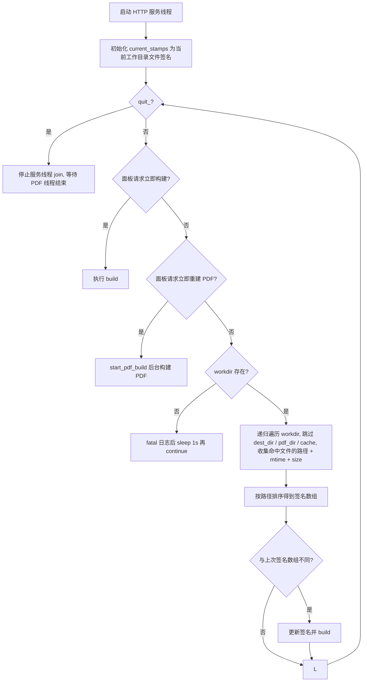

# 7. 监听模式与本地服务

实现：`writer::watch()`（`camus/src/writer.cpp`）。由 `-W/--watch` 触发；启动前会先执行一次 `build()`。

## 7.1 本地 HTTP 服务

| 项 | 值 | 来源 |
|---|---|---|
| 端口 | `3001`（固定常量） | `writer.cpp` `constexpr uint16_t server_port = 3001` |
| 监听地址 | `0.0.0.0`（所有网卡） | `watch_server_.listen("0.0.0.0", server_port)` |
| 文档根 | `./dist/html`（固定） | `watch_server_.set_mount_point("/", conf_.camus().dest_dir())` |
| 框架 | cpp-httplib | `common/common/net` |
| 写超时 | `60s`（构建期间接口可能等待输出目录互斥） | `watch_server_.set_write_timeout(60)` |

`net::get_local_addr(dns_server="114.114.114.114")` 通过向 DNS 地址建立 UDP `connect`（不发送数据）并 `getsockname` 获取本机 IPv4 地址；失败返回空串，`watch()` 中 `assert(!server_addr.empty())`。服务实际绑定 `0.0.0.0`，`get_local_addr()` 得到的地址仅用于拼接日志中可直接访问的 URL（原样返回取得的 IPv4，不做 fake-ip 网段改写）。

服务在线程中运行，主线程负责轮询。

监听模式下 `public_url` 会在配置解析后被清空，因此构建产物使用根相对路径（`with_prefix(path)` 前缀为空时原样返回 `path`），避免指向公网的绝对地址在本地失效。`build.env` 不因监听模式清空，需要本地根相对资源时把 `assets_cdn` 留空。

## 7.2 轮询与重建



- 轮询间隔：`1000ms`（`writer.cpp` watch 主循环）。
- 参与变更检测的文件（递归遍历整个 `workdir`）：
  - 扩展名为 `.md`、`.yaml`、`.json`；
  - **或**路径字符串中包含 `/theme/` 的任意文件；
  - **或**路径字符串中包含 `/assets/` 的任意文件（图片、字体等静态资源修改也会触发重建）。
- 遍历前对 `workdir`、`dest_dir`（`./dist/html`）、`pdf_dir`（`./dist/pdf`）与 PDF 缓存目录（`dest_dir` 的同级 `cache`，即 `./dist/cache`）统一做 `weakly_canonical` 规范化；遍历时同时跳过这三个目录（目录本身不进入、子目录不再递归）。其中 `dist/cache` 存放浏览器 profile 与远程图片缓存，Chrome 运行期间会频繁写入，若不排除会导致签名反复变化而死循环。因此 `index.md`、`index.html` 等构建产物都不会参与检测，符号链接工作目录（如 macOS `/tmp` → `/private/tmp`）也不会因前缀不匹配而漏排除。
- 变更签名：每个命中文件记录「规范化绝对路径 + `mtime` + `size`」，按路径排序后与上次的签名数组逐项比较；不再读取文件内容计算 hash，降低大站点轮询开销。
- 遍历使用 `directory_options::skip_permission_denied`，并通过 `std::error_code` 跳过遍历或 `last_write_time` / `file_size` 失败的条目（权限不足、文件在遍历中被删除/替换），不中断轮询。
- 首次进入循环时用当前签名初始化基线（`current_stamps`），只有签名数组变化才触发 `build()`。
- 不存在内容级构建缓存：命中变化后执行完整 `build()`，每次构建都会清空并重写输出目录，因此资源新增 / 修改 / 删除都会反映到 `dist/html`。
- **构建串行化**：HTML 构建全程持有 `build_mutex_`（`writer.h`）。监听主循环的文件变更重建与控制面板的「立即构建」都通过 `build()` 进入，因此两者不会并发；PDF 后台线程读取 `dist/html`（字体与样式）时也使用同一把锁。

## 7.3 PDF 在监听模式下的行为

| 场景 | 行为 |
|---|---|
| `-W` 首次构建 | HTML 构建完成后**自动启动一次** PDF 后台构建（`start_pdf_build()`），不阻塞监听循环 |
| `-W` 之后的文件变更重建 | **不再**自动构建 PDF（`pdf_auto_started_` 标记） |
| 控制面板「立即重建 PDF」 | 触发一次 PDF 后台构建（可重复触发，构建中再次点击会被忽略） |
| 非监听模式（`-b`） | PDF 在后台线程构建，`build()` 等待其结束后才返回，进程退出前 PDF 已完成 |

- PDF 构建使用**状态快照**（`writer.h` 的 `pdf_context`）：配置、目录树、模板数据与独立的 inja 环境都在构建开始前拷贝到快照中，后台线程不再读取主线程的可变状态，因此可与 HTML 构建并行而不产生数据竞争。
- 快照中的目录树会清空 `render_data_.page.contents`（PDF 不使用渲染后的正文 HTML），降低快照内存占用。
- 远程封面由主线程下载到临时文件；快照会复制一份交给后台线程，副本在 PDF 构建结束后删除，避免与主线程的临时文件清理冲突。
- 监听模式下 `dist/pdf` **只在首次构建时清理**：之后 PDF 由控制面板手动重建，若每次构建都清理会删掉已生成的 PDF（详见 §6.1）。
- PDF 构建期间若 HTML 构建正在进行，PDF 线程会等待 `build_mutex_` 后再复制 `dist/html/fonts` 与 `dist/html/css/style.css`；HTML 构建不会等待 PDF 线程。
- 详细流程见 §6.10。

## 7.4 控制面板（watch.js）

监听模式下构建器会在每个 HTML 页面注入 `<script src="/js/watch.js"></script>`（`writer::flush_writes()`，仅 `.html` 文件，注入位置为 `</body>` 之前；模板没有 `</body>` 时追加到文末）。脚本位于资源目录 `assets/js/watch.js`（安装包随 `example/assets` 一起分发）；若本地 `assets/` 未提供该文件，`ensure_watch_script()` 会从数据目录补齐到输出目录 `dist/html/js/watch.js`，补齐失败时输出 WARN（控制面板不可用）。

界面（原生 JS + 注入样式，不依赖主题 CSS）：

| 元素 | 说明 |
|---|---|
| 闪电悬浮球 | 固定在页面右下角，点击展开 / 收起控制面板 |
| 标题行 | 显示「Camus 监听控制台」与程序版本 |
| HTML 构建 | 上次构建时间（本地时区）、构建耗时、内容数量（文章数）与输出体积 |
| PDF 构建 | 上次构建时间、构建耗时、状态（空闲 / 构建中 / 已完成 / 失败）、页数与文章数 |
| 立即构建 | 请求一次 HTML 构建（`POST /__camus/build`），由监听主循环执行，完成后页面自动刷新 |
| 立即重建 PDF | 请求一次 PDF 构建（`POST /__camus/pdf`），构建中按钮禁用并显示「PDF 构建中…」 |
| 查看 PDF | PDF 构建完成后可点击：服务端把 PDF 复制到 HTML 输出目录并返回 URL，前端用新标签页打开 |

- 页面每秒轮询一次 `GET /__camus/status`；`html.seq` 变化表示构建完成，此时刷新当前页面（刷新前把滚动位置写入 `sessionStorage`，刷新后恢复）。
- 脚本自身的地址用于推导接口根地址（`.../js/watch.js` 之前的部分），因此站点挂在子路径下也能正常工作。
- 接口不可用时（未通过监听服务访问）面板提示「未连接到监听服务」，不影响页面其它功能。

## 7.5 控制面板接口

接口由 `writer::register_watch_api()` 注册在 `httplib::Server` 的 pre-routing 处理器上，路径前缀 `/__camus/`（在静态资源挂载点之前拦截，避免与 `dist/html` 的文件路由冲突）。响应均为 `application/json`，并带 `Cache-Control: no-store`。

| 方法 | 路径 | 说明 | 响应 |
|---|---|---|---|
| `GET` | `/__camus/status` | 查询构建状态 | 见下方状态结构 |
| `POST` | `/__camus/build` | 请求一次 HTML 构建（由监听主循环执行，异步） | 当前状态 JSON |
| `POST` | `/__camus/pdf` | 请求一次 PDF 构建（后台线程，异步） | 当前状态 JSON |
| `POST` | `/__camus/pdf/view` | 把最新 PDF 复制到 HTML 输出目录并返回可访问 URL | `{"ok":true,"url":"/<文件名>"}`；无 PDF 时 `404` 与 `{"ok":false,...}` |
| 其它 | `/__camus/*` | 未匹配 | `404` |

状态结构（`writer::watch_status_json()`）：

```json
{
  "version": "19.4.0",
  "html": {
    "seq": 3,
    "time": "2026-11-26 12:17:23",
    "timestamp": 1795666643,
    "elapsed": 0.085,
    "files": 21,
    "bytes": 237030,
    "articles": 7
  },
  "pdf": {
    "seq": 1,
    "state": "done",
    "time": "2026-11-26 12:17:28",
    "timestamp": 1795666648,
    "elapsed": 4.52,
    "articles": 7,
    "pages": 18,
    "file": "Musicals.pdf",
    "error": ""
  }
}
```

- `html.seq` 每次 HTML 构建完成递增，前端据此判断需要刷新页面；`pdf.seq` 每次 PDF 构建完成递增。
- `html.time` / `pdf.time` 为本地时区时间（`YYYY-MM-DD HH:MM:SS`）；`timestamp` 为 Unix 秒。
- `pdf.state`：`idle`（未构建）/ `running`（构建中）/ `done`（完成）/ `failed`（失败，错误见 `pdf.error`）。
- `pdf.file` 是实际生成的 PDF 文件名。文件名由 `pdf.build` 的 `--print-to-pdf` 决定（默认 `dist/pdf/index.pdf`），用户修改该参数后文件名会变，状态接口与「查看 PDF」都以实际文件名为准。

## 7.6 日志

启动时输出：

```text
watch directory: <workdir>
watch server listen on http://localhost:3001 or http://<addr>:3001
```

工作目录不存在时循环内 `logging::fatal("watch directory not exists ...")`（进程退出 127）。

## 7.7 生命周期与限制

- `quit_` 为 `std::atomic<bool>`，当前代码中**没有任何地方将其置为 true**，也没有注册信号处理；因此监听模式只能由外部终止进程（如 Ctrl+C）结束，`watch_server_.stop()` 分支实际上不可达。
- 端口固定 3001，不支持配置；被占用时 `listen` 失败，服务线程退出，但主循环仍继续轮询。
- 输出目录 `./dist/html` 与 PDF 目录 `./dist/pdf` 已在变更检测中排除（含 PDF 的 `index.md` 等产物），构建不会触发持续重建。
- 每次 `build()` 会重新 `reload()` 配置；`camus.yaml` 内容与上次已加载内容一致时 `reload()` 直接返回（不重复解析、不重扫 `SUMMARY.md`），内容变化时才重载；注意配置重载的列表累积问题（§3.9）。
- `-W` 下首次构建失败不会阻止进入监听循环。
- 监听循环退出时会 `stop()` 服务、join 服务线程并等待 PDF 线程结束。
