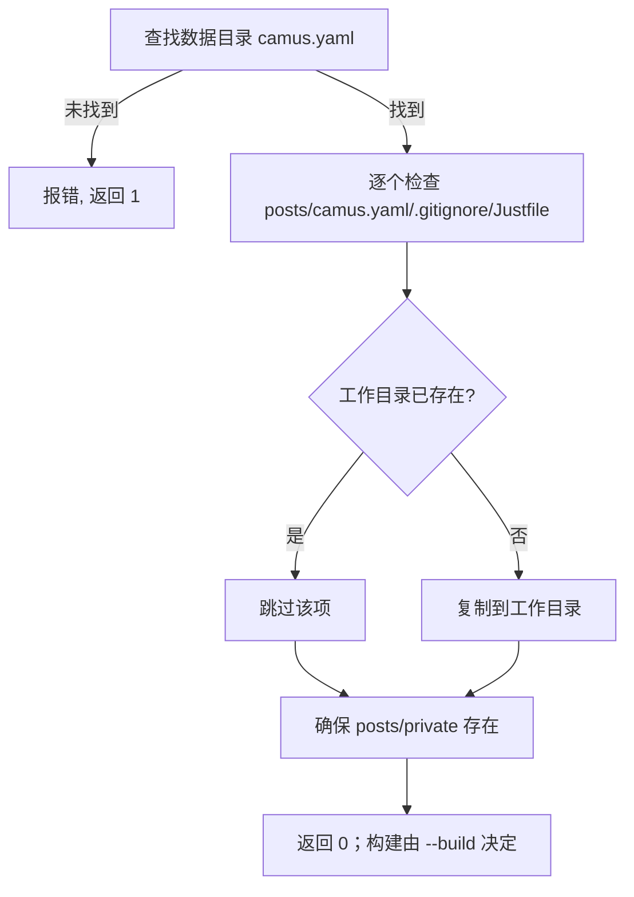
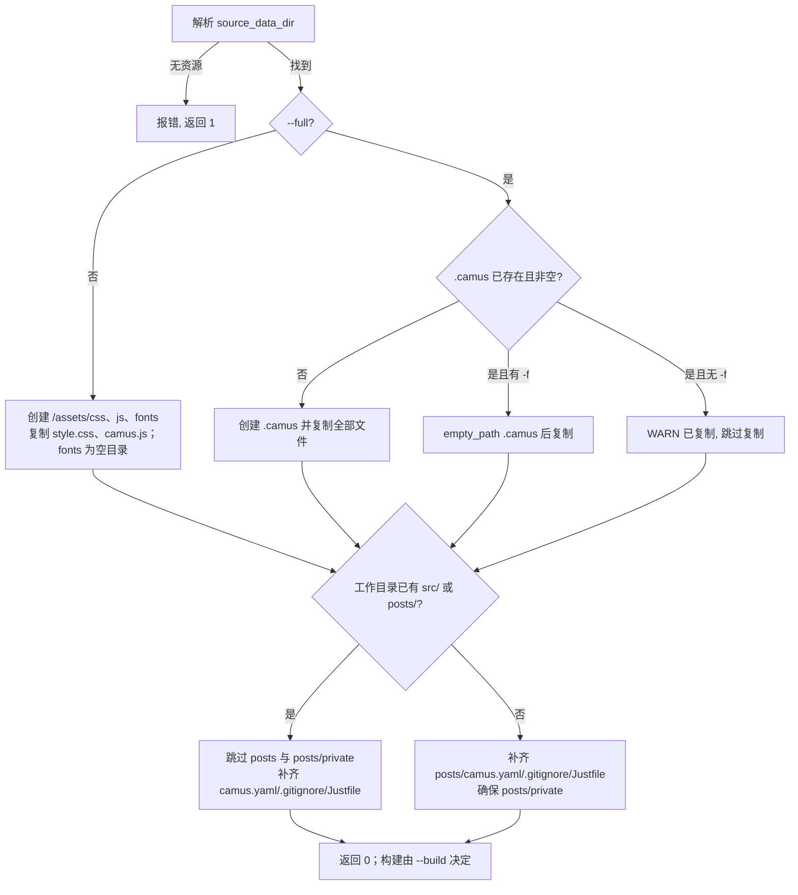
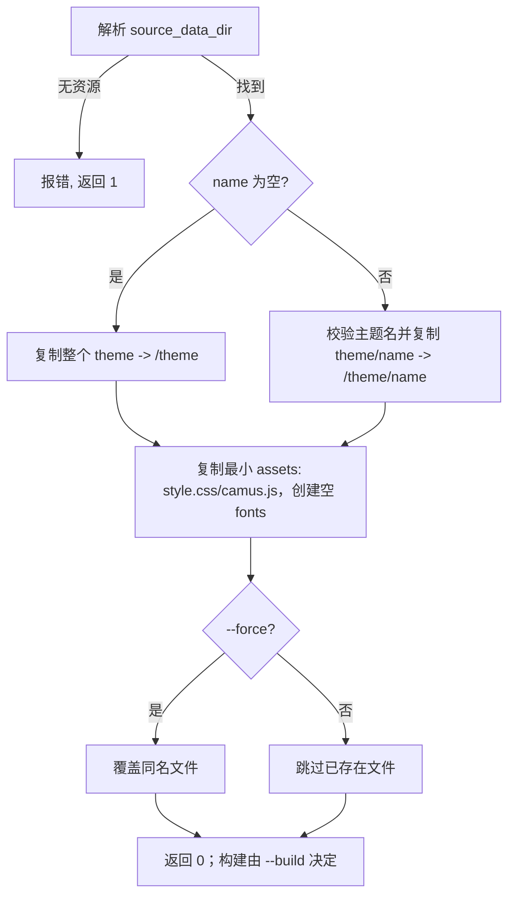

# 8. 资源安装与数据目录

实现：`camus/src/install.h`、`camus/src/install.cpp`、`common/common/paths/paths.h`、`common/common/paths/paths.cpp`、`camus/src/yaml_config.cpp`、`camus/src/writer.cpp`、`camus/CMakeLists.txt`。

> 旧版的「单文件自包含」已移除：可执行文件不再追加示例压缩包。`--new` 把示例配置与文章安装到工作目录根部；`-c/--copy` 默认把最小资源骨架复制到工作目录 `assets/`，`-c --full` 才把完整资源复制到 `.camus`，`-c --theme [name]` 把整个或单个主题复制到 `theme/` 并补齐最小资源。`--install` 已移除，示例文件安装仅由 `--new` 触发。

## 8.1 数据目录

运行期资源根目录由 `camus::paths` 解析（`paths.cpp`）：

| 平台 | 默认数据目录 | 回退 |
|---|---|---|
| macOS | `~/Library/Application Support/Camus`（`$HOME` 存在时） | `/Library/Application Support/Camus` |
| Linux | `/var/lib/camus` | 无 |

- 常量来源：`config.h.in` 的 `CAMUS_DATA_DIR_MACOS`（`Library/Application Support/Camus`）与 `CAMUS_DATA_DIR_LINUX`（`/var/lib/camus`）。
- `data_dirs()` 返回按优先级排列的候选目录；`find(relative)` 返回第一个存在的候选路径。
- `source_data_dir()` 返回第一个同时包含 `theme/` 与 `assets/` 的数据目录，供 `-c` 使用。
- `runtime_dir()` 返回**运行期目录**：候选数据目录中第一个包含 `theme/` 的目录（安装包写入主题的位置；macOS 安装包只装到当前用户域 `~/Library/Application Support/Camus`，旧版系统域安装为 `/Library/Application Support/Camus`）；没有候选目录包含 `theme/` 时回退到平台默认数据目录。`--open runtime` 打开的就是它，`projects.json` 也优先存放在它（不可写时回退到平台默认数据目录，见 §2.8）。
- `paths::find(CAMUS_CONF_NAME)` 定位包含 `camus.yaml` 的数据目录，供 `--new` 安装示例文件使用。
- 构建过程不会向数据目录写入；只有运行期状态 `projects.json`（已记录项目清单，见 §2.8）由 `--open` / `--project` 写入，存放目录不存在时自动创建（`--open runtime` 本身不会创建目录）。

目录内容（由安装包写入）：

```text
<数据目录>/
├── theme/{default,document,pixel,terminal,tomato}/{home,page,stats,friends}.html
├── theme/{tomato,pixel}/search.html
├── theme/pdf/{page.html,style.css,fonts.css}   # PDF 模板、打印样式与字体样式
├── SKILLS/                   # AI 技能库（与 theme 同级，见 §11.3）
│   ├── AGENTS.root.md        # 项目根短入口：只提示先读 .agents/AGENTS.md
│   ├── AGENTS.md             # 技能总纲：强制工作流、类型判定与技能索引
│   ├── {blog,website,tech,book}/*.md    # 24 个技能文件
│   └── novel/{online,western-illusion,simple}/*.md    # 21 个小说技能文件
├── assets/                    # 默认静态资源（css/js/fonts/imgs/robots.txt 等）
│   ├── css/style.css          # 公共样式入口，默认空文件
│   ├── js/camus.js           # 公共脚本入口，默认空文件
│   ├── js/watch.js           # 监听模式控制面板脚本（仅 -W 注入页面，详见 §7.4）
│   └── fonts/                 # 站点与 PDF 共用的字体文件
├── posts/                     # 示例文章
│   ├── SUMMARY.md              # 示例站点与目录元信息（可配置 PDF cover 与 HTML logo）
│   ├── .agents/skills/         # AI 技能在内容目录中的同源镜像（visibility: hidden，不参与构建）
│   └── private/                # 不参与构建的私有内容目录（安装时自动创建，含 README.md）
├── camus.yaml                 # 示例配置
├── .gitignore                 # 示例忽略规则
├── Justfile                   # 示例常用命令
├── bin/camus                  # macOS pkg：可执行文件（/usr/local/bin/camus 指向它的软链）
└── projects.json              # 运行期状态：已记录项目清单（由 --open / --project 写入，非安装包内容）
```

- 上表中的目录即**运行期目录**（`paths::runtime_dir()`）：macOS 安装包只装到当前用户域 `~/Library/Application Support/Camus`（可执行文件也在该目录的 `bin/` 下），Linux 为 `/var/lib/camus`；`--open runtime` 打开该目录，`projects.json` 也优先写入该目录。旧版系统域安装的 `/Library/Application Support/Camus` 仅作为只读回退。

## 8.2 安装与复制

### 8.2.1 `--new`（示例文件安装）

`install_templates()` 只由 `--new` 调用，从 `paths::find("camus.yaml")` 所在的数据目录，把以下内容复制到工作目录根部（已存在的同名路径跳过）：

- `posts/`（含各目录的 `SUMMARY.md`）
- `posts/private/`（不存在时也会自动创建，并写入说明用途的 `README.md`）
- `camus.yaml`
- `.gitignore`
- `Justfile`（常用命令脚本）



- 不会创建或修改 `.camus`。
- 无论 `posts/` 是否已存在，都会确保 `<工作目录>/posts/private/` 存在，并在缺失时写入 `README.md`（`CAMUS_PRIVATE_DIR`）；这与 `--copy` 的「已有 `src/` / `posts/` 时跳过 posts」规则不同。
- 工作目录不存在时自动创建（`create_directories`），因此 `--new /tmp/site` 可直接用于全新目录。
- `--new` 在模板与 AI 技能安装完成后自动执行 `git init`（相当于 `--repo`；显式给出 `--repo` 时按其值初始化并设置 `origin`），详见 §2.4。
- 成功后不退出；是否构建由 `--build`（或 `-W` / `--check` / `--open`）决定（见 §2.4）。
- 执行前会先做 AI 技能冲突预检，复制完成后再把技能整体安装到项目根 `.agents/`（见 §8.2.4）；不打印复制结果表格。

### 8.2.2 `-c/--copy`（最小资源到 `assets/` / `--full` 完整资源到 `.camus`）

`copy_resources()` 根据 `--full` 选择复制范围：

- 默认（最小）：只创建 `<workdir>/assets/css`、`assets/js` 与 `assets/fonts`，并从数据目录复制 `css/style.css`、`js/camus.js`；`fonts/` 只创建空目录（资源目录合并查找，无需复制内置字体）；目标文件已存在且未指定 `-f` 时跳过。
- `--full`：把 `source_data_dir()` 的全部内容复制到 `<workdir>/.camus`。
- 两种模式随后都会调用 `scaffold_workdir()` 补齐工作目录根部的示例文件；但 `--copy` 下若工作目录已存在 `src/` 或 `posts/`，则跳过 `posts`（也不创建 `posts/private/`），避免给已有源目录的项目注入示例文章。



- 最小复制可重复执行：`-f` 覆盖已有的 `style.css` / `camus.js`，未指定时保留现有文件；`fonts/` 只确保存在，不写入内置字体，已有内容保留。
- `--full` 下 `.camus` 已存在且非空、未指定 `-f`：打印 WARN，仅补齐工作目录根部示例文件，不覆盖 `.camus`。
- `--full -f`：先删除 `.camus`（受 §6.1 的 >200 文件保护），再复制。
- 复制完成后，对 `posts`、`camus.yaml`、`.gitignore`、`Justfile`：仅当工作目录根部不存在同名路径时才补齐；工作目录已有 `src/` 或 `posts/` 时跳过 `posts`，此时也不再创建 `posts/private/`；其余情况下 `posts/private/` 始终确保存在。
- 工作目录不存在时由 `<workdir>/assets` 或 `<workdir>/.camus` 的 `create_directories` 一并创建。
- 复制结果持久于磁盘；`-c` 成功后不会退出，是否构建由 `--build` 决定（见 §2.4）。
- 执行前会先做 AI 技能冲突预检，复制完成后把技能整体安装到项目根 `.agents/`（见 §8.2.4），最后打印复制结果表格（见 §8.2.5）。

### 8.2.3 `-c --theme [name]`（复制主题与最小资源）

`copy_theme()` 复制 `source_data_dir()/theme` 这个范围，并同时复制最小资源骨架：

- `-c --theme`：复制整个 `theme/`（含 `theme/pdf/`）。
- `-c --theme pixel`：只复制 `theme/pixel/` 到 `<workdir>/theme/pixel`。
- 同时复制最小资源：`assets/css/style.css`、`assets/js/camus.js`，并创建空 `assets/fonts/`；不复制其他 assets，不补齐工作目录根部的 `posts` / `camus.yaml` / `.gitignore` / `Justfile`，也不受 `--full` 影响。
- 不加 `-f` 时跳过目标中已存在的文件（可重复执行补齐缺失主题）；加 `-f` 时覆盖同名文件。
- `--theme` 未搭配 `-c` 时打印错误并返回 1；主题名非法（绝对路径或含 `.` / `..`）时返回 1。
- 完成后同样打印复制结果表格（见 §8.2.5），主题本身记为 `theme` 或 `theme/<name>` 一行。



### 8.2.4 AI 技能安装到项目根（`-c` / `--new`）

`install_agents()`（`camus/src/install.cpp`）把短入口安装到**项目根**，把技能总纲与技能库整体安装到**项目根 `.agents/`**，供 AI 协作者直接读取：

| 来源（数据目录 `SKILLS/`） | 目标 |
|---|---|
| `AGENTS.root.md` | `<workdir>/AGENTS.md`（短入口，只提示先读 `.agents/AGENTS.md`） |
| `AGENTS.md` | `<workdir>/.agents/AGENTS.md` |
| `blog/`、`website/`、`tech/`、`book/` 下的全部文件 | `<workdir>/.agents/<类型>/<文件>` |
| `novel/<子类型>/` 下的全部文件 | `<workdir>/.agents/novel/<子类型>/<文件>` |

- **不再写入源目录**：安装动作不创建 `<source>/AGENTS.md`，技能内容只放在项目根 `.agents/` 下。
- **执行时机**：`check_agents()` 在其它复制动作**之前**做冲突预检；实际的 `install_agents()` 在模板 / 资源复制**之后**执行。冲突时不会写入任何技能文件。
- **来源查找**：`paths::find_resource("SKILLS")` —— 先工作目录 `.camus/SKILLS`，再平台数据目录 `SKILLS`；两者都不存在时打印 WARN 并跳过（不影响其它安装动作）。
- **冲突处理**：目标文件已存在且内容与来源一致 → 覆盖写入同内容（重复执行幂等）；目标内容不同且未指定 `-f/--force` → 打印冲突路径并终止复制，返回 1；指定 `-f/--force` → 覆盖写入。`--copy` 下若 `<workdir>/AGENTS.md` 已存在，则**跳过该文件并打印 ERROR**（不覆盖用户文件，继续其余复制）；只有 `-f/--force` 才覆盖。`--new` 下项目根 `AGENTS.md` 内容不同仍按冲突终止。
- **持久性**：`<workdir>/AGENTS.md` 与 `<workdir>/.agents/` 持久于磁盘；删除后可重新安装，被用户修改后需改名或使用 `--force`。
- **构建忽略**：任意 `AGENTS.md` 与任意 `.agents/` 目录在构建时强制忽略（与 `private` 同级，见 §4.1），不进入目录树、页面或 PDF；项目根 `AGENTS.md` 与 `.agents/` 不在源目录内，构建本来就不会扫描。
- **记忆目录**：安装动作不创建 `<workdir>/.agents/memories/`；该目录由 AI 首次运行时按需建立，不参与构建，也不会被安装或 `--force` 覆盖（见 §11.6）。
- 技能内容、类型判定与总纲约定详见 §11。

### 8.2.5 复制结果表格（`-c`）

`-c`（含 `--full`、`--theme`）成功后由 `print_copy_report()` 在标准输出打印一张表格；`--new` 不打印。

| 列 | 内容 |
|---|---|
| `Item` | 复制项的相对位置，**只到目录级别**：`AGENTS.md`（项目根短入口）、`.agents/AGENTS.md`、`.agents/<类型>`（同一技能目录下的文件合并为一行，不列出文件）、`assets/css`、`assets/js`、`assets/fonts`、`posts`、`posts/private`、`camus.yaml`、`.gitignore`、`Justfile`、`.camus/<顶层条目>`、`theme`、`theme/<name>` |
| `Result` | 按状态着色：`copied` / `created` 绿色，`overwritten` / `merged` 黄色，`kept` 灰色，`skipped …` 红色。取值为 `copied` / `overwritten` / `created` / `kept` / `merged` / `skipped (exists)` / `skipped (source exists)` / `skipped (already installed)` / `skipped (missing in source)`；同一目录下多个文件的聚合结果按「有新增 → `copied`；仅内容变化 → `overwritten`；全部一致 → `kept`」计算 |
| `Target` | 目标目录相对 `<workdir>` 的路径（由 `print_copy_report(report, workdir)` 传入基准目录） |

- 表格按 `Item` 与 `Result` 的显示宽度对齐；颜色在补齐宽度后套用，不影响对齐。示例：

```text
Copy result:
Item                    Result   Target
---------------------------------------------
assets/css              created  assets/css
assets/fonts            kept     assets/fonts
posts                   copied   posts
posts/private           kept     posts/private
camus.yaml              copied   camus.yaml
.agents/AGENTS.md        copied   .agents/AGENTS.md
.agents/website         copied   .agents/website
```

- `skipped (source exists)` 仅用于 `-c` 且工作目录已有 `src/` 或 `posts/` 时的 `posts` 行；此时不创建 `posts/private/`。
- 表格只反映本次命令的复制动作，不会因为资源已存在而改变函数返回码（仍返回 0）。

## 8.3 资源查找顺序

主题查找：工作目录 `theme/` → `.camus/theme` → 平台数据目录。静态资源：平台数据目录 `assets` → `.camus/assets` → 本地 `./assets`（后层覆盖前层）。

主题（`yaml_config.cpp` 的 `read_theme()`）：

1. 工作目录 `theme/{theme_name}/{type}.html`（显式本地覆盖）。
2. `paths::find_resource("theme/{theme_name}/{type}.html")`：先 `.camus/theme/...`，再数据目录。
3. 均不存在时 `logging::fatal("read theme content failed name=...")`，退出 127。

PDF 模板、样式与字体（`writer.cpp` 的 `read_pdf_theme_file()` / `copy_pdf_asset_fonts()`）：

1. 工作目录 `theme/pdf/{page.html,style.css,fonts.css}`（显式本地覆盖，可只覆盖单个文件）。
2. `paths::find_resource("theme/pdf/<file>")`：先 `.camus/theme/pdf/...`，再数据目录。
3. `page.html` / `style.css` 均不存在时 `logging::fatal("read pdf theme content failed name=...")`，退出 127；`fonts.css` 可选。
4. 字体不放在 `theme/pdf/`：使用站点 `assets/fonts/`，构建后由 `copy_pdf_asset_fonts()` 复制到 `dist/pdf/fonts/`，`fonts.css` 以 `fonts/<file>` 引用。

静态资源（`writer::emit_assets()`）：

1. 平台数据目录 `assets/`（`paths::resource_assets_dir()`）作为基础资源。
2. `.camus/assets`：存在且非空时覆盖基础资源（`-c --full` 的完整复制）。
3. 本地 `./assets`：存在且非空时整体覆盖前两层。
4. 三者都不可用时记录 debug 并跳过。
5. 资源最终提升到输出根目录（详见 §6.8）。

## 8.4 安装位置（CPack）

`camus/CMakeLists.txt` 安装 `example/` 下的 `theme/`、`assets/`、`posts/`（含各目录的 `SUMMARY.md`）、`camus.yaml`、`.gitignore` 与 `Justfile`，AI 技能库 `SKILLS/`（构建期从 `example/posts/.agents/skills` 复制到 `<构建目录>/pkg/SKILLS`），以及可执行文件：

| 平台 / 生成器 | 安装目标 |
|---|---|
| Linux（DEB） | 资源 → `var/lib/camus`（最终 `/var/lib/camus`）；可执行文件 → `/usr/local/bin/camus` |
| macOS（productbuild） | 仅当前用户域：资源 → `Library/Application Support/Camus` → `~/Library/Application Support/Camus`；可执行文件 → `~/Library/Application Support/Camus/bin/camus`，由安装脚本建立 `/usr/local/bin/camus` 软链 |

- 安装 `example/theme` 的整个目录，因此包含 `theme/pdf/{page.html,style.css,fonts.css}` 与 `example/assets`（含 `fonts/`）。
- 安装 `example/posts` 的整个目录，因此包含 `posts/.agents/skills/`（技能在内容目录中的同源镜像，不参与构建）。
- `SKILLS/` 与 `theme/`、`assets/` 安装到同一目录（macOS productbuild 归入 `Resources` 组件），供 §8.2.4 分发到项目根目录；技能来源是真实路径，安装包内为真实文件。
- macOS 通过 `CPACK_PRODUCTBUILD_DOMAINS` **只启用当前用户域**（`CPACK_PRODUCTBUILD_DOMAINS_USER=ON`，`..._ROOT` / `..._ANYWHERE=OFF`），因此 `installer -pkg <file> -target CurrentUserHomeDirectory` 会把整个包释放到当前用户目录；不再提供系统域安装。旧版系统域安装（`/Library/Application Support/Camus`）仍作为只读回退被 §8.1 的 `data_dirs()` 找到。
- 安装完成后由 `scripts/install.sh` / `make install` / CI 执行 `sudo ln -sf "$HOME/Library/Application Support/Camus/bin/camus" /usr/local/bin/camus`，使 `camus` 在 PATH 中可用。
- 卸载：`rm -f /usr/local/bin/camus`，删除 `~/Library/Application Support/Camus`，再 `pkgutil --forget io.github.the-writer.Camus.Runtime` / `...Resources`。

## 8.5 持久性

- `--new` 安装的根部示例文件与 `posts/private/` 持久于工作目录；`-c` 最小复制持久于工作目录 `assets/`，`-c --theme` 持久于 `theme/`，`-c --full` 持久于 `.camus`；`-f` 可覆盖已有资源。
- AI 技能安装的项目根 `AGENTS.md` 与 `.agents/` 持久于项目根；内容被修改后再次安装需 `--force` 覆盖，否则提示冲突并终止复制（`--copy` 下项目根 `AGENTS.md` 已存在时跳过并报错，不终止其余复制）。
- AI 运行时创建的 `.agents/memories/` 同样持久于项目根，不参与构建，也不会被安装动作覆盖（见 §11.6）。
- 数据目录中的资源由安装包持久化；升级安装包会覆盖同名文件。
- 工作目录的 `theme/` 与 `./assets` 始终拥有最高优先级。
