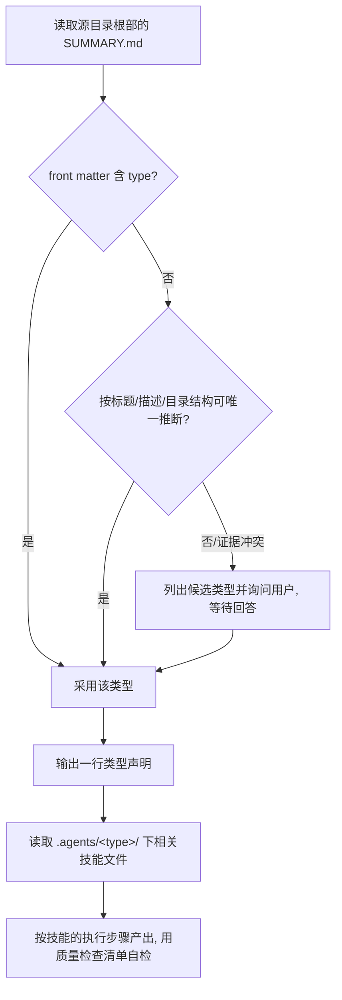

# 11. AI 技能库

> 实现：`example/posts/agents/skills/`（技能内容唯一来源）、`docs/SKILLS`（指向该目录的符号链接）、`camus/CMakeLists.txt`（打包）、`camus/src/install.h`、`camus/src/install.cpp`（`install_agents`）、`camus/main.cpp`（流程编排）。

## 11.1 技能库构成

技能库是一套给 AI 协作者使用的 Markdown 工作规范，按**项目类型**分目录组织。

```text
example/posts/agents/skills/          # 唯一来源（随示例内容分发，不参与构建）
├── AGENTS.md                         # 总纲：类型判定流程 + 技能索引 + 通用规范
├── blog/                             # 6 个技能
├── novel/                            # 6 个技能
├── website/                          # 6 个技能
├── tech/                             # 6 个技能
└── book/                             # 6 个技能
```

| 项 | 值 |
|---|---|
| 类型取值 | `blog`、`novel`、`website`、`tech`、`book`（共 5 类） |
| 每类技能数 | 6（命名 kebab-case，扩展名 `.md`） |
| 单个技能结构 | 用途 / 何时使用 / 输入 / 执行步骤 / 输出格式 / 质量检查清单 / 参考资料 |
| 文档语言 | 中文正文，术语与指标保留英文原名 |
| 外部链接 | 每个技能附 4–6 条已核验可达的参考链接 |

### 11.1.1 类型与技能清单

| 类型 | 适用站点 | 技能 |
|---|---|---|
| `blog` | 博客、专栏、随笔、评测 | `topic-ideation`（选题灵感）、`outline-builder`（结构大纲）、`hook-writer`（标题/开头/摘要）、`readability-score`（可读性评分）、`style-editor`（文风审校与 AI 味清理）、`related-post-finder`（同类文章查找与内链） |
| `novel` | 小说、剧本、诗集 | `premise-generator`（故事灵感与核心设定）、`character-bible`（人物档案与动机链）、`plot-outline`（三幕结构与章节大纲）、`dialogue-polish`（对白打磨与潜台词）、`continuity-audit`（连续性审查）、`scene-tension-score`（场景张力评分） |
| `website` | 产品站、机构站、落地页 | `content-inventory`（内容盘点与信息架构）、`copy-rewrite`（页面文案改写）、`accessibility-audit`（可访问性审查）、`seo-audit`（SEO 与结构化数据）、`navigation-design`（导航与目录结构）、`performance-checklist`（性能与 Core Web Vitals） |
| `tech` | 技术博客、工程文档 | `architecture-review`（架构评审）、`code-review`（代码评审清单）、`api-design`（接口设计与契约）、`test-strategy`（测试策略）、`debug-diagnosis`（故障定位与复盘）、`tech-post-writer`（技术文章写作） |
| `book` | 读书、书评、书摘 | `book-mapper`（书籍地图）、`key-idea-extractor`（核心观点与卡片）、`reading-notes`（结构化读书笔记）、`comparable-books`（同类书籍查找与对比）、`book-review`（书评写作）、`reading-plan`（阅读计划与进度） |

### 11.1.2 内容来源唯一性

- `example/posts/agents/skills/` 是技能内容的**唯一来源**；`docs/SKILLS` 是指向它的**相对符号链接**（`docs/SKILLS -> ../example/posts/agents/skills`），用于文档目录下的查阅与打包。
- 构建期用 `file(REAL_PATH)` 解析符号链接后再复制，得到真实文件（符号链接不进入安装包）。
- `example/posts/agents/skills/**/*.md` 全部带 Front Matter `visibility: hidden`，因此**不出现在构建产物与目录页**中（见 §4.4）；`agents/` 目录因子节点被移除而一并被裁剪。
- 修改技能内容只需改 `example/posts/agents/skills/` 下的文件，`docs/SKILLS` 自动同步。

## 11.2 项目类型判定

技能按类型分发，AI 必须先确定项目类型再加载对应技能。总纲 `AGENTS.md` 规定的工作流：



### 11.2.1 判定信号

| 信号 | 说明 |
|---|---|
| `SUMMARY.md` Front Matter 的 `type` | 显式声明，取值为 5 类之一；构建时忽略该键（§3.2 只读取 title/subtitle/description/cover/logo） |
| `title` / `subtitle` / `description` | 用于推断站点性质（长文 / 产品 / 技术 / 读书） |
| 目录结构 | 例如 `docs/`、`api/` 指向 `tech`；按卷/章划分指向 `novel` |
| 混合站点 | 先定主类型，再跨目录借用其它类型的技能 |

### 11.2.2 强制输出与询问规则

- 任何实质工作开始前，AI 必须先输出一行类型声明：`项目类型：<type>（依据：...）`。
- 出现「`SUMMARY.md` 缺失或线索不足」「多类型同时成立且证据相当」「混合站点无法判断主次」「任务不属于已知五类」时，**必须先向用户提问并等待回答**，不得自行猜测；提问需一次给出 2–4 个候选、各自一句话理由与推荐项。
- 用户纠正类型后必须重新输出类型声明。

## 11.3 打包与安装位置

| 阶段 | 位置 | 说明 |
|---|---|---|
| 构建期暂存 | `<构建目录>/pkg/SKILLS/` | `file(COPY)` + `camus-skills` 自定义目标（`ALL`），每次构建刷新 |
| 安装包内容 | `<平台数据目录>/SKILLS/` | 与 `theme/`、`assets/` **同级**（§8.1） |
| 内容目录 | `<平台数据目录>/posts/agents/skills/` | 随 `example/posts` 一并安装，供 `--new` 分发到内容目录 |

- macOS `productbuild` 中 `SKILLS` 属于 `Resources` 组件；Linux DEB 与 macOS DragNDrop 同为资源安装目标。
- `SKILLS/` 缺失时（例如旧版安装包）`install_agents` 打印 WARN 并跳过，不影响其它安装动作。

## 11.4 安装到项目根目录

### 11.4.1 触发条件与映射

`--new`、`--copy` 两种操作都会把 AI 技能安装到**项目根目录**：

| 来源（数据目录 `SKILLS/`） | 目标（工作目录） |
|---|---|
| `AGENTS.md` | `<workdir>/AGENTS.md` |
| `blog/`、`novel/`、`website/`、`tech/`、`book/` 下的全部文件 | `<workdir>/.agents/<类型>/<文件>` |

- 该动作在其它复制动作**之前**执行（`camus/main.cpp`），冲突时不会留下半安装状态。
- 安装来源按 `paths::find_resource("SKILLS")` 解析：优先工作目录 `.camus/SKILLS`，其次平台数据目录 `SKILLS`。
- 技能文件不影响构建：`<workdir>/AGENTS.md` 与 `<workdir>/.agents/` 不在源目录（`src/` 或 `posts/`）内，不参与目录树扫描。

### 11.4.2 冲突处理

| 情形 | 行为 |
|---|---|
| 目标不存在 | 直接复制 |
| 目标存在且内容与来源一致 | 视为已安装，覆盖写入同内容（重复执行 `--copy` / `--new` 幂等） |
| 目标存在且内容不同、**未**指定 `--force` | 打印每个冲突路径的 ERROR，**终止复制**（不写入任何文件），命令返回 1 |
| 目标存在且内容不同、**指定** `--force` | 覆盖写入 |

冲突提示形如：

```text
[ERRO] agents file already exists path=/path/to/site/AGENTS.md
[ERRO] agents installation aborted: 1 conflicting file(s), remove or rename them, or run with --force to overwrite
```

### 11.4.3 持久性

- `<workdir>/AGENTS.md` 与 `<workdir>/.agents/` 持久于磁盘，刷新与重启不丢失。
- 删除后可用 `--copy` / `--new` 重新安装；内容被用户修改后再次安装会触发冲突，需改名或使用 `--force`。
- 数据目录中的 `SKILLS/` 由安装包持久化，升级安装包会覆盖同名文件。

## 11.5 技能文件编写约定

新增或修改技能时遵循：

1. 文件名 kebab-case，扩展名 `.md`，放在对应类型目录下。
2. Front Matter 只写 `title` 与 `visibility: hidden`。
3. 正文固定七段：用途 / 何时使用 / 输入 / 执行步骤 / 输出格式 / 质量检查清单 / 参考资料。
4. 「输入」表缺失项必须给出「缺失时」的处理方式（向用户索取）。
5. 「输出格式」给出模板骨架，不写成成品文案。
6. 「参考资料」只放已核验可达的链接，并写明链接提供什么。
7. 涉及事实断言（数据、引文、版本、行为）不得编造；无法核实处标注「待核实」。
