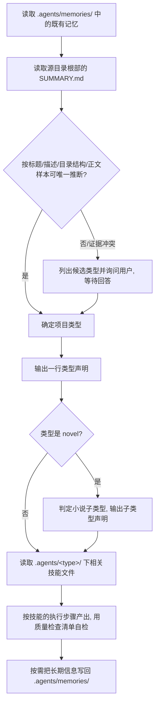

# 11. AI 技能库

> 实现：`example/posts/.agents/skills/`（技能内容唯一来源）、`camus/CMakeLists.txt`（打包）、`camus/src/install.h`、`camus/src/install.cpp`（`install_agents`）、`camus/main.cpp`（流程编排）。

## 11.1 技能库构成

技能库是一套给 AI 协作者使用的 Markdown 工作规范，按**项目类型**分目录组织；小说类型再按**子类型**分目录。

```text
example/posts/.agents/skills/         # 唯一来源（随示例内容分发，不参与构建）
├── AGENTS.md                         # 总纲：类型判定流程 + 技能索引 + 通用规范
├── blog/                             # 6 个技能
├── website/                          # 6 个技能
├── tech/                             # 6 个技能
├── book/                             # 6 个技能
└── novel/                            # 小说：3 个子类型，各 6 个技能
    ├── online/                       # 网文（连载爽文）
    ├── western-illusion/             # 西方奇幻
    └── simple/                       # 普通小说（现实向基线）
```

| 项 | 值 |
|---|---|
| 类型取值 | `blog`、`novel`、`website`、`tech`、`book`（共 5 类） |
| 小说子类型取值 | `online`、`western-illusion`、`simple`（共 3 类，仅 `novel` 适用） |
| 每类技能数 | 6（命名 kebab-case，扩展名 `.md`）；小说按子类型各 6 个 |
| 单个技能结构 | 用途 / 何时使用 / 输入 / 执行步骤 / 输出格式 / 质量检查清单 / 参考资料 |
| 文档语言 | 中文正文，术语与指标保留英文原名 |
| 外部链接 | 每个技能附 4–6 条已核验可达的参考链接 |

### 11.1.1 类型与技能清单

| 类型 | 适用站点 | 技能 |
|---|---|---|
| `blog` | 博客、专栏、随笔、评测 | `topic-ideation`（选题灵感）、`outline-builder`（结构大纲）、`hook-writer`（标题/开头/摘要）、`readability-score`（可读性评分）、`style-editor`（文风审校与 AI 味清理）、`related-post-finder`（同类文章查找与内链） |
| `website` | 产品站、机构站、落地页 | `content-inventory`（内容盘点与信息架构）、`copy-rewrite`（页面文案改写）、`accessibility-audit`（可访问性审查）、`seo-audit`（SEO 与结构化数据）、`navigation-design`（导航与目录结构）、`performance-checklist`（性能与 Core Web Vitals） |
| `tech` | 技术博客、工程文档 | `architecture-review`（架构评审）、`code-review`（代码评审清单）、`api-design`（接口设计与契约）、`test-strategy`（测试策略）、`debug-diagnosis`（故障定位与复盘）、`tech-post-writer`（技术文章写作） |
| `book` | 读书、书评、书摘 | `book-mapper`（书籍地图）、`key-idea-extractor`（核心观点与卡片）、`reading-notes`（结构化读书笔记）、`comparable-books`（同类书籍查找与对比）、`book-review`（书评写作）、`reading-plan`（阅读计划与进度） |

小说类型按子类型分发，三套技能文件名一致、内容按体裁改写：

| 子类型 | 适用作品 | 技能（每个子类型目录下各 6 个） |
|---|---|---|
| `novel/online` | 中文网文、连载爽文 | `premise-generator`（选题与金手指）、`character-bible`（人物与金手指档案）、`plot-outline`（黄金三章与分卷章纲）、`dialogue-polish`（对白与爽点台词）、`scene-tension-score`（章节节奏与爽点）、`continuity-audit`（战力与设定连续性） |
| `novel/western-illusion` | 西方奇幻、史诗奇幻 | `premise-generator`（魔法体系与势力设定）、`character-bible`（队伍与阵营档案）、`plot-outline`（旅程分卷与章纲）、`dialogue-polish`（称谓与语域打磨）、`scene-tension-score`（战斗与探索张力）、`continuity-audit`（世界设定连续性） |
| `novel/simple` | 现实向、人物驱动的普通小说 | `premise-generator`（梗概与控制主题）、`character-bible`（人物档案与生活细节）、`plot-outline`（结构与章纲）、`dialogue-polish`（日常对白打磨）、`scene-tension-score`（场景张力评分）、`continuity-audit`（生活细节与时间线审查） |

### 11.1.2 内容来源唯一性

- `example/posts/.agents/skills/` 是技能内容的**唯一来源**，直接由构建期复制到安装包，不使用符号链接。
- `example/posts/.agents/skills/**/*.md` 全部带 Front Matter `visibility: hidden`，因此**不出现在构建产物与目录页**中（见 §4.4）；`.agents/` 目录因子节点被移除而一并被裁剪。
- 修改技能内容只需改 `example/posts/.agents/skills/` 下的文件，构建后自动同步到安装包。

## 11.2 项目类型判定

技能按类型分发，AI 必须先确定项目类型再加载对应技能。**类型不写在配置里**，由 AI 首次运行时推断。总纲 `AGENTS.md` 规定的工作流：



### 11.2.1 判定信号

| 信号 | 说明 |
|---|---|
| `title` / `subtitle` / `description` | 推断站点性质（文章集 / 产品页 / 工程文档 / 读书 / 文学创作） |
| 目录结构 | 按时间或主题分组 → `blog`；按卷 / 章 / 幕划分 → `novel`；功能页而非文章集 → `website`；含 `docs/` / `api/` → `tech`；以书为单位 → `book` |
| 正文样本 | 读首篇文章 / 首章的标题与开头，确认体裁与读者预期 |
| 既有记忆 | `.agents/memories/project.md` 中上次推断并确认的类型；与当前线索冲突时以当前正文为准 |
| 混合站点 | 先定主类型，再跨目录借用其它类型的技能 |

> `SUMMARY.md` 的 Front Matter 只承载站点元信息（§3.5.1 的 title/subtitle/description/cover/logo），**不写项目类型**；`type` / `novel-type` 不是受支持的配置键。

### 11.2.2 小说子类型判定

类型为 `novel` 时必须二次判定子类型，否则会加载到不适用的写作规范：

| 子类型 | 判定线索 | 技能目录 |
|---|---|---|
| `online` | 「网文 / 连载 / 日更 / 爽文 / 系统流 / 升级流」；按等级或境界划分战力；按「家族→宗门→大陆」推进 | `.agents/novel/online/` |
| `western-illusion` | 「西幻 / 魔法 / 剑与魔法 / 教会 / 公会 / 地下城」；有魔法体系、种族与势力设定 | `.agents/novel/western-illusion/` |
| `simple` | 「短篇 / 中篇 / 家庭 / 职场 / 日常」；冲突来自人物处境，不依赖类型套路 | `.agents/novel/simple/` |

- 子类型同样**不写入配置**，按上表线索从正文样本推断；证据不足时按 §11.2.3 询问用户。
- 推断结果写入 `.agents/memories/project.md`，后续运行直接复用。

### 11.2.3 强制输出与询问规则

- 任何实质工作开始前，AI 必须先输出一行类型声明：`项目类型：<type>（依据：...）`。
- 类型为 `novel` 时，声明之后紧接一行子类型声明：`小说子类型：<subtype>（依据：...）`。
- 出现「`SUMMARY.md` 缺失或线索不足」「多类型同时成立且证据相当」「混合站点无法判断主次」「任务不属于已知五类」「小说子类型无法判定」时，**必须先向用户提问并等待回答**，不得自行猜测；提问需一次给出 2–4 个候选、各自一句话理由与推荐项。
- 用户纠正类型或子类型后必须重新输出对应声明。

## 11.3 打包与安装位置

| 阶段 | 位置 | 说明 |
|---|---|---|
| 构建期暂存 | `<构建目录>/pkg/SKILLS/` | `file(COPY)` + `camus-skills` 自定义目标（`ALL`），每次构建刷新 |
| 安装包内容 | `<平台数据目录>/SKILLS/` | 与 `theme/`、`assets/` **同级**（§8.1） |
| 内容目录 | `<平台数据目录>/posts/.agents/skills/` | 随 `example/posts` 一并安装，供 `--new` 分发到内容目录 |

- macOS `productbuild` 中 `SKILLS` 属于 `Resources` 组件；Linux DEB 与 macOS DragNDrop 同为资源安装目标。
- `SKILLS/` 缺失时（例如旧版安装包）`install_agents` 打印 WARN 并跳过，不影响其它安装动作。

## 11.4 安装到项目根目录

### 11.4.1 触发条件与映射

`--new`、`--copy` 两种操作都会把 AI 技能安装到**项目根目录**：

| 来源（数据目录 `SKILLS/`） | 目标（工作目录） |
|---|---|
| `AGENTS.md` | `<workdir>/AGENTS.md` |
| `blog/`、`website/`、`tech/`、`book/` 下的全部文件 | `<workdir>/.agents/<类型>/<文件>` |
| `novel/<子类型>/` 下的全部文件 | `<workdir>/.agents/novel/<子类型>/<文件>` |

- 该动作在其它复制动作**之前**执行（`camus/main.cpp`），冲突时不会留下半安装状态。
- 安装来源按 `paths::find_resource("SKILLS")` 解析：优先工作目录 `.camus/SKILLS`，其次平台数据目录 `SKILLS`。
- 技能文件不影响构建：`<workdir>/AGENTS.md` 与 `<workdir>/.agents/` 不在源目录（`src/` 或 `posts/`）内，不参与目录树扫描。
- 安装动作**不创建** `<workdir>/.agents/memories/`；该目录由 AI 在首次运行时按需创建（见 §11.6），不会被安装或 `--force` 覆盖。

### 11.4.2 冲突处理

| 情形 | 行为 |
|---|---|
| 目标不存在 | 直接复制 |
| 目标存在且内容与来源一致 | 视为已安装，覆盖写入同内容（重复执行 `--copy` / `--new` 幂等） |
| 目标存在且内容不同、**未**指定 `--force` | 打印每个冲突路径的 ERROR，**终止复制**（不写入任何文件），命令返回 1 |
| 目标存在且内容不同、**指定** `--force` | 覆盖写入 |

冲突提示形如：

```text
[ERRO] agents file already exists path=/path/to/site/AGENTS.md
[ERRO] agents installation aborted: 1 conflicting file(s), remove or rename them, or run with --force to overwrite
```

### 11.4.3 持久性

- `<workdir>/AGENTS.md` 与 `<workdir>/.agents/` 持久于磁盘，刷新与重启不丢失。
- 删除后可用 `--copy` / `--new` 重新安装；内容被用户修改后再次安装会触发冲突，需改名或使用 `--force`。
- 数据目录中的 `SKILLS/` 由安装包持久化，升级安装包会覆盖同名文件。

## 11.5 技能文件编写约定

新增或修改技能时遵循：

1. 文件名 kebab-case，扩展名 `.md`，放在对应类型目录下；小说技能放在 `novel/<子类型>/` 下，子类型目录名固定为 `online` / `western-illusion` / `simple`。
2. Front Matter 只写 `title` 与 `visibility: hidden`。
3. 正文固定七段：用途 / 何时使用 / 输入 / 执行步骤 / 输出格式 / 质量检查清单 / 参考资料。
4. 「输入」表缺失项必须给出「缺失时」的处理方式（向用户索取）。
5. 「输出格式」给出模板骨架，不写成成品文案。
6. 「参考资料」只放已核验可达的链接，并写明链接提供什么。
7. 涉及事实断言（数据、引文、版本、行为）不得编造；无法核实处标注「待核实」。

## 11.6 记忆（`.agents/memories/`）

AI 需要跨会话保留的信息，按类别写成独立文件放在**项目根**的 `.agents/memories/` 下；总纲 `AGENTS.md` 规定首次运行先读、结束后按需写回。

| 项 | 值 |
|---|---|
| 位置 | `<workdir>/.agents/memories/` |
| 创建者 | AI 在首次运行时创建（安装包不提供、`--new` / `--copy` 不复制） |
| 持久性 | 持久于磁盘；与 `AGENTS.md`、`.agents/` 互不影响 |
| 是否参与构建 | 不参与：不在源目录（`posts/` 或 `src/`）内，不被扫描或发布 |
| 是否会被安装覆盖 | 不会：`install_agents` 只写 `AGENTS.md` 与各类型技能目录，不触碰 `memories/` |

### 11.6.1 文件分类

| 文件 | 放什么 | 不写什么 |
|---|---|---|
| `project.md` | 项目类型、小说子类型、推断依据、用户确认记录 | 具体情节 |
| `preferences.md` | 用户偏好：语气、篇幅、更新节奏、禁区与尺度、命名习惯 | 作品设定 |
| `style.md` | 文风约定：人称、时态、句长、术语表、禁用词 | 情节梗概 |
| `characters.md` | 人物档案、关系网、弧线节点、语言特征 | 正文段落 |
| `world.md` | 世界观：魔法体系、种族与势力、地图与地标 | 人物的私密动机 |
| `outline.md` | 结构、分卷 / 章节大纲、当前进度、伏笔状态 | 已完成章节的正文 |
| `continuity.md` | 事实台账、已发现的一致性问题与处理结果 | 未经核实的主观判断 |

分类可按项目需要增删；一个文件只放一类信息。

### 11.6.2 读写规则

1. **先读后写**：每次运行先读已有记忆；目录不存在就跳过，不视为错误。
2. **首次写入类型**：完成类型（与小说子类型）推断后立即写 `project.md`，记录结果、依据与确认状态。
3. **增量更新**：只改受影响的条目，不整篇重写；每条记录写清「依据 / 日期 / 确认状态」。
4. **冲突以正文为准**：记忆是工作缓存，不是事实来源；与正文或用户新指令冲突时以正文 / 新指令为准，并同步修正记忆。
5. **控制体量**：单文件过大（经验值：超过约 200 行）就按主题拆分。
6. **不写机密**：密码、令牌、密钥、他人隐私不写入记忆。
