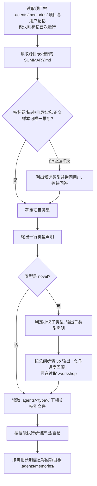

# 11. AI 技能库

> 实现：`example/posts/.agents/skills/`（技能内容唯一来源）、`shared/`（公共片段）、`camus/CMakeLists.txt`（打包）、`camus/src/install.h`、`camus/src/install.cpp`（`install_agents`）、`camus/main.cpp`（流程编排）。

## 11.1 技能库构成

技能库是一套给 AI 协作者使用的 Markdown 工作规范，按**项目类型**分目录组织；小说类型再按**子类型**分目录。

```text
example/posts/.agents/skills/         # 唯一来源（随示例内容分发，不参与构建）
├── AGENTS.root.md                    # 项目根短入口：提示先读 .agents/AGENTS.md
├── AGENTS.md                         # 总纲：强制工作流 + 类型判定 + 技能索引 + 通用规范
├── shared/                           # 公共片段（通用规则 / 记忆 / .workshop / git 评审 / 小说公共块）
├── blog/                             # 6 个技能
├── website/                          # 6 个技能
├── tech/                             # 6 个技能
├── book/                             # 6 个技能
└── novel/                            # 小说：3 个子类型，各 7 个技能
    ├── online/                       # 网文（连载爽文）
    ├── western-illusion/             # 西方奇幻
    └── simple/                       # 普通小说（现实向基线）
```

| 项 | 值 |
|---|---|
| 类型取值 | `blog`、`novel`、`website`、`tech`、`book`（共 5 类） |
| 小说子类型取值 | `online`、`western-illusion`、`simple`（共 3 类，仅 `novel` 适用） |
| 每类技能数 | 6（命名 kebab-case，扩展名 `.md`）；小说按子类型各 7 个（多一个 `outline-map`） |
| 单个技能结构 | 用途 / 何时使用 / 输入 / 执行步骤 / 输出格式 / 质量检查清单 / 参考资料（小说任务的「创作进度回顾」由总纲强制工作流统一规定，技能文件不重复） |
| 文档语言 | 中文正文，术语与指标保留英文原名 |
| 外部链接 | 每个技能附 4–6 条已核验可达的参考链接 |

### 11.1.1 类型与技能清单

| 类型 | 适用站点 | 技能 |
|---|---|---|
| `blog` | 博客、专栏、随笔、评测 | `topic-ideation`（选题灵感）、`outline-builder`（结构大纲）、`hook-writer`（标题/开头/摘要）、`readability-score`（可读性评分）、`style-editor`（文风审校与 AI 味清理）、`related-post-finder`（同类文章查找与内链） |
| `website` | 产品站、机构站、落地页 | `content-inventory`（内容盘点与信息架构）、`copy-rewrite`（页面文案改写）、`accessibility-audit`（可访问性审查）、`seo-audit`（SEO 与结构化数据）、`navigation-design`（导航与目录结构）、`performance-checklist`（性能与 Core Web Vitals） |
| `tech` | 技术博客、工程文档 | `architecture-review`（架构评审；有 `.git` 时结合当前改动与记忆）、`code-review`（代码评审清单；有 `.git` 时综合评价当前修改）、`api-design`（接口设计与契约）、`test-strategy`（测试策略）、`debug-diagnosis`（故障定位与复盘）、`tech-post-writer`（技术文章写作） |
| `book` | 读书、书评、书摘 | `book-mapper`（书籍地图）、`key-idea-extractor`（核心观点与卡片）、`reading-notes`（结构化读书笔记）、`comparable-books`（同类书籍查找与对比）、`book-review`（书评写作）、`reading-plan`（阅读计划与进度） |

小说类型按子类型分发，三套技能文件名一致、内容按体裁改写：

| 子类型 | 适用作品 | 技能（每个子类型目录下各 7 个） |
|---|---|---|
| `novel/online` | 中文网文、连载爽文 | `premise-generator`（选题与金手指）、`character-bible`（人物与金手指档案）、`plot-outline`（黄金三章与分卷章纲）、`outline-map`（创作脉络与大纲地图）、`dialogue-polish`（对白与爽点台词）、`scene-tension-score`（章节节奏与爽点）、`continuity-audit`（战力与设定连续性） |
| `novel/western-illusion` | 西方奇幻、史诗奇幻 | `premise-generator`（魔法体系与势力设定）、`character-bible`（队伍与阵营档案）、`plot-outline`（旅程分卷与章纲）、`outline-map`（创作脉络与大纲地图）、`dialogue-polish`（称谓与语域打磨）、`scene-tension-score`（战斗与探索张力）、`continuity-audit`（世界设定连续性） |
| `novel/simple` | 现实向、人物驱动的普通小说 | `premise-generator`（梗概与控制主题）、`character-bible`（人物档案与生活细节）、`plot-outline`（结构与章纲）、`outline-map`（创作脉络与大纲地图）、`dialogue-polish`（日常对白打磨）、`scene-tension-score`（场景张力评分）、`continuity-audit`（生活细节与时间线审查） |

### 11.1.2 内容来源唯一性

- `example/posts/.agents/skills/` 是技能内容的**唯一来源**，直接由构建期复制到安装包，不使用符号链接。
- `shared/` 是跨技能公共片段层：通用规则、记忆与用户画像、`.workshop` 契约、git 评审、小说脉络 / 人物 / 连续性公共块。技能文件只写自身特有内容，通用规则变化只改 `shared/`。
- 技能文件（`AGENTS.md` 与各类型目录下的 `*.md`）带 Front Matter `visibility: hidden`；项目根短入口 `AGENTS.root.md` 不含 Front Matter（它只安装为项目根 `AGENTS.md`，不进入 `.agents/`）。此外构建会强制忽略任意 `.agents/` 目录与 `AGENTS.md` 文件（见 §4.1），因此技能内容不会出现在构建产物与目录页中。
- 修改技能内容只需改 `example/posts/.agents/skills/` 下的文件，构建后自动同步到安装包。

## 11.2 项目类型判定

技能按类型分发，AI 必须先确定项目类型再加载对应技能。**类型不写在配置里**，由 AI 首次运行时推断。总纲 `AGENTS.md` 规定的工作流：



> 首次运行（`.agents/memories/` 或 `project.md` 缺失）在完成类型 / 子类型判定后、进入技能前执行「首次记忆初始化」：写 `project.md` 的汇总信息与 `user/` 用户画像占位，之后只做增量更新（见 §11.6.3）。

### 11.2.1 判定信号

| 信号 | 说明 |
|---|---|
| `title` / `subtitle` / `description` | 推断站点性质（文章集 / 产品页 / 工程文档 / 读书 / 文学创作） |
| 目录结构 | 按时间或主题分组 → `blog`；按卷 / 章 / 幕划分 → `novel`；功能页而非文章集 → `website`；含 `docs/` / `api/` → `tech`；以书为单位 → `book` |
| 正文样本 | 读首篇文章 / 首章的标题与开头，确认体裁与读者预期 |
| 既有记忆 | 项目根 `.agents/memories/project.md` 中上次推断并确认的类型；与当前线索冲突时以当前正文为准 |
| 混合站点 | 先定主类型，再跨目录借用其它类型的技能 |

> `SUMMARY.md` 的 Front Matter 只承载站点元信息（§3.5.1 的 title/subtitle/description/cover/logo），**不写项目类型**；`type` / `novel-type` 不是受支持的配置键。

### 11.2.2 小说子类型判定

类型为 `novel` 时必须二次判定子类型，否则会加载到不适用的写作规范：

| 子类型 | 判定线索 | 技能目录 |
|---|---|---|
| `online` | 「网文 / 连载 / 日更 / 爽文 / 系统流 / 升级流」；按等级或境界划分战力；按「家族→宗门→大陆」推进 | `.agents/novel/online/` |
| `western-illusion` | 「西幻 / 魔法 / 剑与魔法 / 教会 / 公会 / 地下城」；有魔法体系、种族与势力设定 | `.agents/novel/western-illusion/` |
| `simple` | 「短篇 / 中篇 / 家庭 / 职场 / 日常」；冲突来自人物处境，不依赖类型套路 | `.agents/novel/simple/` |

- 子类型同样**不写入配置**，按上表线索从正文样本推断；证据不足时按 §11.2.3 询问用户。
- 推断结果写入项目根 `.agents/memories/project.md`，后续运行直接复用。

### 11.2.3 强制输出与询问规则

- 任何实质工作开始前，AI 必须先输出一行类型声明：`项目类型：<type>（依据：...）`。
- 类型为 `novel` 时，声明之后紧接一行子类型声明：`小说子类型：<subtype>（依据：...）`。
- 出现「`SUMMARY.md` 缺失或线索不足」「多类型同时成立且证据相当」「混合站点无法判断主次」「任务不属于已知五类」「小说子类型无法判定」时，**必须先向用户提问并等待回答**，不得自行猜测；提问需一次给出 2–4 个候选、各自一句话理由与推荐项。
- 用户纠正类型或子类型后必须重新输出对应声明。

## 11.3 打包与安装位置

| 阶段 | 位置 | 说明 |
|---|---|---|
| 构建期暂存 | `<构建目录>/pkg/SKILLS/` | `file(COPY)` + `camus-skills` 自定义目标（`ALL`），每次构建刷新 |
| 安装包内容 | `<平台数据目录>/SKILLS/` | 与 `theme/`、`assets/` **同级**（§8.1） |
| 内容目录 | `<平台数据目录>/posts/.agents/skills/` | 随 `example/posts` 一并安装，供 `--new` 分发到内容目录 |

- macOS `productbuild` 中 `SKILLS` 属于 `Resources` 组件；Linux DEB 与 macOS DragNDrop 同为资源安装目标。
- `SKILLS/` 缺失时（例如旧版安装包）`install_agents` 打印 WARN 并跳过，不影响其它安装动作。

## 11.4 安装到项目根

### 11.4.1 触发条件与映射

`--new`、`--copy` 两种操作都会把 AI 技能安装到**项目根**：短入口放在项目根 `AGENTS.md`，其余内容整体放入项目根 `.agents/`：

| 来源（数据目录 `SKILLS/`） | 目标 |
|---|---|
| `AGENTS.root.md` | `<workdir>/AGENTS.md`（短入口，提示先读 `.agents/AGENTS.md`） |
| `AGENTS.md` | `<workdir>/.agents/AGENTS.md`（技能总纲） |
| `shared/` 下的全部文件 | `<workdir>/.agents/shared/<文件>`（公共片段） |
| `blog/`、`website/`、`tech/`、`book/` 下的全部文件 | `<workdir>/.agents/<类型>/<文件>` |
| `novel/<子类型>/` 下的全部文件 | `<workdir>/.agents/novel/<子类型>/<文件>` |

- **不再写入源目录**：安装动作不创建、也不修改 `<source>/AGENTS.md`（`src/` 或 `posts/` 根部的 `AGENTS.md`），技能内容只在项目根 `.agents/` 下。
- **执行顺序**：冲突预检在其它复制动作**之前**执行（`check_agents`），实际写入在模板 / 资源复制**之后**（`install_agents`）；有冲突时不会留下半安装状态。
- 安装来源按 `paths::find_resource("SKILLS")` 解析：优先工作目录 `.camus/SKILLS`，其次平台数据目录 `SKILLS`。
- 构建强制忽略任意 `AGENTS.md` 文件与任意层级的 `.agents/` 目录（与 `private` 同级处理，见 §4.1）；项目根 `.agents/` 本就不在构建扫描范围内，二者都不会被渲染或发布。
- 安装动作**不创建** `<workdir>/.agents/memories/`；该目录由 AI 在首次运行时按需创建（见 §11.6），不会被安装或 `--force` 覆盖。

### 11.4.2 冲突处理

| 情形 | 行为 |
|---|---|
| 目标不存在 | 直接复制 |
| 目标存在且内容与来源一致 | 视为已安装，覆盖写入同内容（重复执行 `--copy` / `--new` 幂等） |
| 目标存在且内容不同、**未**指定 `--force` | 打印每个冲突路径的 ERROR，**终止复制**（不写入任何文件），命令返回 1 |
| `--copy` 且项目根 `AGENTS.md` 已存在、**未**指定 `--force` | **跳过该文件**并打印 ERROR，继续复制其余技能文件；不覆盖用户已有文件，不按冲突终止 |
| 目标存在且内容不同、**指定** `--force` | 覆盖写入 |

冲突提示形如：

```text
[ERRO] agents file already exists path=/path/to/site/.agents/AGENTS.md
[ERRO] agents installation aborted: 1 conflicting file(s), remove or rename them, or run with --force to overwrite
```

`--copy` 跳过项目根 `AGENTS.md` 时只打印第一条，形如：

```text
[ERRO] agents file already exists, skip copying path=/path/to/site/AGENTS.md
```

### 11.4.3 持久性

- `<workdir>/AGENTS.md` 与 `<workdir>/.agents/` 持久于磁盘，刷新与重启不丢失。
- 删除后可用 `--copy` / `--new` 重新安装；内容被用户修改后再次安装会触发冲突，需改名或使用 `--force`（`--copy` 下项目根 `AGENTS.md` 已存在时跳过并报错，`--force` 才覆盖）。
- 数据目录中的 `SKILLS/` 由安装包持久化，升级安装包会覆盖同名文件。

## 11.5 技能文件编写约定

新增或修改技能时遵循：

1. 文件名 kebab-case，扩展名 `.md`，放在对应类型目录下；小说技能放在 `novel/<子类型>/` 下，子类型目录名固定为 `online` / `western-illusion` / `simple`。
2. Front Matter 只写 `title` 与 `visibility: hidden`。
3. 正文固定七段：用途 / 何时使用 / 输入 / 执行步骤 / 输出格式 / 质量检查清单 / 参考资料；**小说技能不再单独写 `## 创作进度` 一节**，进度回顾统一由总纲 `AGENTS.md` 的强制工作流规定（见 §11.7）。
4. 「输入」表只列本技能特有输入；记忆、用户记忆、正文、`SUMMARY.md`、`.workshop/` 等通用输入见 `shared/common.md` 与 `shared/novel-map.md`。缺失项必须给出「缺失时」的处理方式（向用户索取或标注假设）。
5. 「输出格式」给出模板骨架，不写成成品文案。
6. 「参考资料」只放已核验可达的链接，并写明链接提供什么；通用链接放 `shared/` 对应文件，技能只列特有链接。
7. 涉及事实断言（数据、引文、版本、行为）不得编造；无法核实处标注「待核实」（见 `shared/common.md`）。
8. 小说任务的进度回顾必须注明数据来源，取不到就写「未记录」；`.workshop/` 存在时按 `shared/workshop.md` 交叉核对，不存在时不视为错误。
9. 评审 / 评价类技能在项目根存在 `.git/` 时，按 `shared/git-review.md` 读取当前改动并结合记忆做综合评价；git 只读，不自动提交。
10. **通用规则不重复**：记忆与用户画像、`.workshop`、git 评审、小说脉络 / 人物 / 连续性公共块分别写入 `shared/` 对应文件；技能文件只写自身特有内容，引用相对路径。

## 11.6 记忆（项目根 `.agents/memories/`）

> 实现：`example/posts/.agents/skills/shared/memory.md`（唯一细则来源）；本节描述行为，技能文件只引用该公共文件。

AI 需要跨会话保留的信息，按类别写成独立文件放在**项目根**的 `.agents/memories/` 下；用户画像单独放在 `.agents/memories/user/`。总纲 `.agents/AGENTS.md` 规定首次运行先读、缺失时初始化、结束后按需写回。

| 项 | 值 |
|---|---|
| 位置 | `<workdir>/.agents/memories/`（与技能总纲 `.agents/AGENTS.md` 同级） |
| 创建者 | AI 在首次运行时创建（安装包不提供、`--new` / `--copy` 不复制） |
| 持久性 | 持久于磁盘；与 `AGENTS.md`、`.agents/` 互不影响 |
| 是否参与构建 | 不参与：项目根 `.agents/` 不在构建扫描范围内 |
| 是否会被安装覆盖 | 不会：`install_agents` 只写项目根 `AGENTS.md` 与 `.agents/` 下的技能文件，不触碰 `memories/` |

### 11.6.1 文件分类

| 文件 | 放什么 | 不写什么 |
|---|---|---|
| `project.md` | 项目类型、小说子类型、推断依据、用户确认记录、首次初始化的项目概览（定位 / 读者 / 范围 / 阶段 / 约束） | 具体情节 |
| `preferences.md` | 用户偏好：语气、篇幅、更新节奏、禁区与尺度、命名习惯 | 作品设定 |
| `style.md` | 文风约定：人称、时态、句长、术语表、禁用词 | 情节梗概 |
| `characters.md` | 人物档案、关系网、弧线节点、语言特征 | 正文段落 |
| `world.md` | 世界观：魔法体系、种族与势力、地图与地标 | 人物的私密动机 |
| `outline.md` | 结构、分卷 / 章节大纲、当前进度、进度快照与创作数据（章数 / 字数 / 伏笔统计）、伏笔状态 | 已完成章节的正文 |
| `continuity.md` | 事实台账、已发现的一致性问题与处理结果 | 未经核实的主观判断 |
| `user/<用户>.md` | 用户画像：性格与沟通、工作方法、喜好与禁区、创作习惯、协作偏好 | 敏感个人信息、人格诊断、一次性任务安排 |

分类可按项目需要增删；一个文件只放一类信息。`user/` 按用户分文件，默认 `user/default.md`（见 §11.6.4）。

### 11.6.2 读写规则

1. **先读后写**：每次运行先读已有记忆（`project.md` 与按需的 `user/<用户>.md`）；目录不存在就跳过，不视为错误。
2. **首次初始化**：完成类型（与小说子类型）推断后立即写 `project.md` 与 `user/` 占位，见 §11.6.3。
3. **增量更新**：只改受影响的条目，不整篇重写；每条记录写清「依据 / 日期 / 确认状态」。
4. **冲突以正文为准**：记忆是工作缓存，不是事实来源；与正文或用户新指令冲突时以正文 / 新指令为准，并同步修正记忆。
5. **控制体量**：单文件过大（经验值：超过约 200 行）就按主题拆分。
6. **不写机密**：密码、令牌、密钥、他人隐私不写入记忆。
7. **用户画像不越界**：只记录可观察、可复用的协作偏好；不确定先问，不把推断写成事实。

### 11.6.3 首次记忆初始化

触发条件：`.agents/memories/` 不存在、`project.md` 缺失或缺少「项目概览」、`user/` 下没有可用文件（即需要初始化）。

时机：完成 §11.2 的类型（与小说子类型）判定后、加载技能与开始实质工作前，补齐缺失部分。

1. 创建 `.agents/memories/`（已存在则保留）。
2. 写 `project.md`：类型 / 子类型、推断依据、用户确认状态；并增加「项目概览」——一句话定位、目标读者、主要内容范围与关键目录、当前阶段、已知约束与待确认项。
3. 创建 `user/default.md`（已知用户名时用 `user/<用户>.md`）：只写本次可观察到的协作偏好；没有可靠信息时保留标题与「待确认」，不凭空推断性格。
4. 只补齐缺失部分；已有 `project.md` 时只增量更新，不重建、不覆盖。

### 11.6.4 用户记忆（`user/`）

路径：`.agents/memories/user/<用户>.md`；无法确定用户身份时用 `user/default.md`。一个用户一个文件，不合并不同用户。

| 维度 | 记什么 | 不记什么 |
|---|---|---|
| 性格与沟通 | 直接 / 委婉偏好、节奏、解释深度、反馈方式 | 心理诊断、人格标签 |
| 工作方法 | 先大纲还是先正文、迭代方式、评审与确认习惯、工具偏好 | 一次性任务安排 |
| 喜好与禁区 | 题材、语气、篇幅、命名、尺度、明确反感 | 未经确认的猜测 |
| 创作习惯 | 人称 / 时态、结构、节奏、母题、审美参照 | 具体作品情节 |
| 协作偏好 | 提问频率、是否要方案对比、决策方式 | 敏感个人信息 |

文件建议结构（可按需增删）：

```markdown
# 用户画像：<用户>

## 沟通与协作
- <结论>（依据：<...>；日期：<YYYY-MM-DD>；确认状态：用户确认 / 观察推断 / 待确认）

## 工作方法
- <结论>（依据：<...>；日期：<...>；确认状态：<...>）

## 喜好与禁区
- <结论>（依据：<...>；日期：<...>；确认状态：<...>）

## 创作习惯
- <结论>（依据：<...>；日期：<...>；确认状态：<...>）
```

- **按需读取**：创作、改写、评审、规划、风格调整与方案类任务先读；纯事实查询或机械操作可跳过。
- **主动评估时机**：首次运行；任务结束出现新的重复偏好 / 有效工作方法 / 明确禁区；用户纠正或表达不满；同一信号连续出现 3 次以上。
- **写入规则**：每条标注「用户确认 / 观察推断 / 待确认」+ 依据 + 日期；只写稳定、可复用的结论，没有新信息就不写，不为「有记忆」而凑内容。
- **用途**：调整提问方式、方案详略、写作风格与交付顺序；不用于给用户贴人格标签。
- **不打断主任务**：首次初始化或任务结束时做增量更新，必要时用一句话说明；不确定或涉及敏感信息时先问，不擅自写入。

## 11.7 创作进度回顾

> 实现：技能总纲 `AGENTS.md` §0 步骤 3b（强制工作流）；小说技能文件不再各写一节，本节的统计口径与模板与该步骤保持一致。

所有小说任务（3 个子类型 × 7 个技能）在判定类型与子类型后、进入技能正文前，**统一按总纲 §0 步骤 3b 先输出进度回顾**。本节的统计口径与输出模板只用于说明该步骤；技能文件不重复这些内容。

### 11.7.1 数据源

| 数据源 | 读取内容 | 缺失时 |
|---|---|---|
| `.agents/memories/` | `project.md`、`outline.md` 必读；按需读 `characters.md`、`world.md`、`continuity.md`、`preferences.md`、`style.md` | 目录或文件不存在就跳过，不视为错误 |
| `.agents/memories/user/<用户>.md`（可选） | 用户的创作偏好、节奏、审美与协作方式；用于调整回顾的详略与建议排序 | 不存在时跳过，不视为错误 |
| 源目录 | `posts/`（不存在则 `src/`）下的卷 / 章（或篇 / 章）文件 | 无正文时按「只有大纲」模式回顾，并注明覆盖范围 |
| `.workshop/`（可选） | 设定卡、地名、关系、候选、图谱（见 §11.8） | 不存在时跳过；进度表中 `.workshop` 设定卡标「无」 |

### 11.7.2 统计口径与输出

| 项 | 口径 | 取不到时 |
|---|---|---|
| 当前阶段 | 开坑 / 连载中 / 修稿 / 完结，依据最近章节与记忆判断 | 「未记录」 |
| 上次更新 | 最新章节日期或记忆中的日期 | 「未记录」 |
| 卷 / 篇数、章数 | 源目录中的卷目录与章节文件数；`simple` 子类型可用篇数 / 章数 | 「未记录」 |
| 已完成章节 | 有正文且非占位内容的章节数 | 「未记录」 |
| 总字数 / 章均字数 | 正文字符数统计 | 「未记录」 |
| 伏笔 | 埋 / 收 / 未收三条计数 | 「未记录」 |
| 人物 / 地点 / 关系 / 候选 | 记忆与 `.workshop` 条目数 | 「未记录」 |
| `.workshop` 设定卡 | `sheets.md` 的 `##` 卡片数 | 「无」 |

输出模板（与 `AGENTS.md` §0 步骤 3b 一致）：

```markdown
## 创作进度回顾
- 当前阶段：<开坑 / 连载中 / 修稿 / 完结>（依据：<...>）
- 上次更新：<日期 / 最新一章>（依据：<...>）

| 项 | 数值 | 来源 |
|---|---|---|
| 卷 / 篇数、章数 | <...> | <...> |
| 已完成章节 | <...> | <...> |
| 总字数 / 章均字数 | <...> | <...> |
| 伏笔 | 埋 <X> / 收 <Y> / 未收 <Z> | <...> |
| 人物 / 地点 / 关系 / 候选 | <...> | <...> |
| `.workshop` 设定卡 | <... / 无> | <...> |

- 当前进度：<写到哪一卷 / 哪一篇的哪一章，主线停在哪>
- 待续事项：<接下来 1–3 件，按优先级>
```

### 11.7.3 回写与持久性

- 进度与创作数据的**快照**写入 `outline.md`，持久于磁盘，刷新 / 重启不丢失；统计值可从源目录重新计算，快照只是上次回顾的结果。
- 本次任务改变进度、伏笔或设定时，增量更新 `outline.md` 与对应类别文件；不得整篇重写。
- 冲突优先级：正文 > 用户新指令 > `.agents/memories/` > `.workshop/`；冲突处必须标注，不静默采信。
- 取不到的数值一律写「未记录」，**不估算、不编造**。

## 11.8 创作脉络与 `.workshop` 交叉分析

> 实现：`example/posts/.agents/skills/shared/workshop.md`（`.workshop` 契约）、`shared/novel-map.md`（公共输出）；`novel/{online,western-illusion,simple}/outline-map.md` 只写各自的结构与专项。`.workshop` 由外部「创作工坊 / Creation Workshop」维护，AI 只读。

`outline-map` 是每个小说子类型的第 7 个技能：把「大纲 + 正文 + 记忆 + `.workshop`」合成一张可核对的创作地图，输出分卷 / 阶段推进、主线与支线台账、人物弧线、伏笔状态、设定资产使用情况与下一步建议。

### 11.8.1 分析范围

| 子类型 | 结构骨架 | 重点检查 |
|---|---|---|
| `online` | 长线目标 → 分卷 → 章纲 | 黄金三章、分卷目标与跃迁、地图与势力台阶、金手指代价、爽点兑现、章末钩子 |
| `western-illusion` | 受雇 → 启程 → 试炼 → 深入 → 回归 → 余波 | 地标是否复用、中间地带、魔法规则一致性、势力与 BOSS 阶梯、冒险后勤 |
| `simple` | 开端 / 上升 / 中段转折 / 收紧 / 高潮与收束（或起承转合 / 自由结构） | 转折是否由人物触发、场景与概述配比、人物弧线落点、生活细节是否被回收 |

### 11.8.2 `.workshop/` 文件契约

`<workdir>/.workshop/` 为可选目录；存在时按下表读取，不存在时整节跳过。

| 文件 | 内容 | 读取方式 | 用途 |
|---|---|---|---|
| `project.md` | 项目总览、设定、总纲 / 章节清单 | Markdown | 对照总纲与分析范围；注意它可能是计划，不等于正文进度 |
| `overview.md` | 总览 | Markdown，可为空 | 空文件跳过 |
| `sheets.md` | 设定卡：人物名、族群、性别、职业、籍贯、关系、备注 | `##` 分卡；`- 字段: 值` 取字段 | 建人物与关系底账 |
| `places.md` | 地名：名称、族群、备注、结构 | 同上；`- 结构:` 下为缩进子字段 | 建地点底账，对照正文地标 / 场景 |
| `relations.md` | 关系：来源 / 目标 / 关系类型 | 同上 | 校验人物关系与图谱连线 |
| `candidates.md` | 名称候选：族群、类型、性别、稀有度、字数、来源、收藏 | 同上 | 找尚未使用的命名资产 |
| `graph.md` | 节点数、连线数、节点快照、连线快照、布局坐标 | Markdown 列表与表格 | 核对数量、孤儿节点与孤立设定 |
| `preferences.md` | 生成规则、候选库筛选条件 | JSON 代码块 | 只作生成偏好，不作情节事实 |
| `sheets.ini` | 人物 / 候选速查 | INI：`[人物]`、`[候选]` 分节，`名称 = 备注` | 与 `sheets.md` 交叉核对，冲突以 `sheets.md` 为准 |

### 11.8.3 交叉核对与冲突处理

- 核对四类差异：**正文有、卡片没有**；**卡片有、正文没用**；**关系不一致**；**候选 / 地标闲置**。
- 冲突优先级：正文 > 用户新指令 > `.agents/memories/` > `.workshop/`。
- AI **不修改** `.workshop/`（由外部工具维护），只把结论写回 `.agents/memories/`（`outline.md`、`characters.md`、`world.md`、`continuity.md`）。
- 输出必须包含：结构地图（mermaid）、分卷 / 阶段表、线索台账、人物弧线、`.workshop` 交叉核对表、缺口与风险、1–3 项下一步。

## 11.9 评价类技能的 git 综合评价

> 实现：`example/posts/.agents/skills/shared/git-review.md`（唯一细则来源）；`tech/code-review.md` 与 `tech/architecture-review.md` 只引用。

评审 / 评价类技能（`code-review`、`architecture-review`、`*-audit`、`*-score`、`continuity-audit`、`readability-score` 等）在**项目根存在 `.git/`** 时，不能只评价用户贴出的片段，必须把「当前改动 + 仓库基线 + 记忆」合起来看。

| 项 | 要求 |
|---|---|
| 判断 | 只检查项目根是否存在 `.git/`；不存在就跳过本节，按原技能执行 |
| 只读 | `git` 只用于读取，不执行 `add` / `commit` / `reset` / `checkout` / `clean` 等写操作 |
| 读取状态 | 至少读取 `git status --short`、`git diff --stat`、`git diff`（未暂存）、`git diff --cached`（已暂存）；需要时读 `git log -1 --oneline` 确认基线 |
| 读取记忆 | 按任务读 `.agents/memories/` 中的 `project.md`、`preferences.md`、`style.md`、`outline.md`、`continuity.md` 等，以及 `user/<用户>.md` 中的协作偏好 |
| 综合评价 | 对照记忆评价改动范围、一致性、连续性、风险与验证情况；评价「改动本身」与「是否符合项目目标 / 记忆」要分开写 |
| 诚实 | git 不可用、仓库无改动或输出为空时如实说明；不得编造 diff、文件名或提交记录 |
| 不改仓库 | 评价结论只写进交付物或 `.agents/memories/`，不自动提交 |

输出至少包含：改动概览（文件 / 行数 / 暂存状态）、与记忆的一致性、风险项、验证情况、明确结论。
