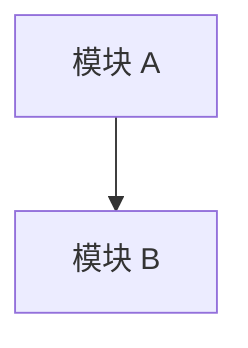

# 架构评审（tech）

> 从模块边界、依赖方向、数据流、失败模式四个角度评审一份设计或一段实现。

## 用途

- 在动手实现前评审设计方案。
- 评审已经写完的模块划分，找出耦合与重复。
- 为「为什么这样拆」留下可复核的理由。

## 何时使用

- 设计文档评审；
- 重构前评估影响面；
- 新增一个跨模块功能时；
- 线上问题暴露出结构性问题时。

## 输入

| 输入 | 说明 | 缺失时 |
|---|---|---|
| 设计说明 / 代码结构 | 被评审对象 | 必须有 |
| 约束条件 | 规模、团队、期限、运行环境 | 向用户确认 2–3 条 |
| 目标 | 这套设计要解决什么 | 必须有 |
| 现状 | 已有系统的关键事实 | 从代码或文档抽取 |
| 仓库状态 / 记忆（可选） | 有 `.git/` 时按 `.agents/shared/git-review.md`；记忆按 `.agents/shared/memory.md` | 无 `.git/` 时只评设计本身并说明 |

## 执行步骤

1. **有 `.git/` 时先看当前改动**：按 `.agents/shared/git-review.md` 读取状态、diff、基线与记忆，判断这次改动是否属于当前架构目标；git 只读，不提交。
2. **复述目标与约束**：用三句话说清「要解决什么 / 不能违反什么 / 规模多大」。说不清就先问。
3. **画依赖图**：模块与外部依赖，用文字或 mermaid 表达，标出方向。
4. **查边界**：每个模块的职责是否单一；有没有「万能工具模块」。
5. **查依赖方向**：是否出现环依赖；是否从业务层反向依赖基础设施细节。
6. **查数据流**：数据在哪里产生、经过谁、被谁消费；有没有隐式共享状态。
7. **列失败模式**：每个外部依赖失败时会怎样（超时、返回脏数据、部分成功）。
8. **评估演进成本**：需求变化 1（规模 ×10）、变化 2（多一种存储）、变化 3（多一个调用方）时，改动面有多大。
9. **给结论与替代方案**：至少给一个更简单的替代设计，并说明取舍。

## 评审维度

| 维度 | 问题 | 常见坏味道 |
|------|------|-----------|
| 职责边界 | 一个模块能用一句话说清职责吗 | 「工具」「公共」「common」包 |
| 依赖方向 | 依赖是单向的吗 | 环依赖、上层 import 下层实现 |
| 数据所有权 | 每个数据有唯一归属吗 | 多处可写、共享全局可变状态 |
| 接口稳定性 | 内部实现变动会影响多少调用方 | 跨层暴露内部结构体 |
| 失败处理 | 依赖失败时行为可预测吗 | 吞异常、无限重试、无超时 |
| 可测试性 | 能独立测试核心逻辑吗 | 逻辑埋在 IO 循环里 |
| 可观测性 | 出问题时能定位到哪一层吗 | 无日志、无指标、错误信息丢失上下文 |
| 演进成本 | 常见变化要动几处 | 一处改动要改 5 个文件 |

## 失败模式清单

| 失败 | 需要回答的问题 |
|------|--------------|
| 下游超时 | 超时多长？超时后是重试、降级还是失败？重试是否幂等？ |
| 下游返回脏数据 | 谁负责校验？在边界校验还是内部校验？ |
| 部分成功 | 事务边界在哪？如何补偿？ |
| 磁盘写失败 | 数据丢失可接受吗？是否有落盘确认？ |
| 配置错误 | 缺配置时启动失败还是用默认值？默认值是否安全？ |
| 并发竞争 | 共享状态如何同步？是否存在竞态？ |
| 版本不匹配 | 客户端与服务端版本不一致时的行为？ |

## 输出格式

```markdown
## 目标与约束
- 目标：<...>
- 约束：<...>
- 规模：<...>

## 当前修改评价（有 `.git/` 时）
| 维度 | 结论 | 依据 |
|------|------|------|
| 改动范围 | <...> | <git status / diff --stat> |
| 与架构目标一致 | <...> | <...> |
| 与记忆一致 | <...> | <记忆中的项目目标 / 偏好> |
| 风险 | <...> | <...> |

## 依赖图


## 评审结论
| 维度 | 评价 | 说明 |
|------|------|------|
| 职责边界 | 好 / 可接受 / 需改 | <...> |
...

## 问题清单
| 级别 | 位置 | 问题 | 影响 | 建议 | 成本 |
|------|------|------|------|------|------|
| 高 | 模块 B | <...> | <...> | <...> | <...> |

## 失败模式
| 依赖 | 失败场景 | 当前行为 | 期望行为 | 缺口 |
|------|---------|---------|---------|------|

## 替代方案
<更简单的设计 + 取舍>

## 结论
<可以推进 / 需要先改 N 处 / 建议换方案>
```

## 质量检查清单

- [ ] 开头复述了目标与约束，且来自用户而非猜测；
- [ ] 项目有 `.git/` 时读取了当前改动并对照了记忆；
- [ ] 依赖图覆盖全部模块与外部依赖；
- [ ] 每条问题都给了影响与建议成本；
- [ ] 失败模式覆盖了全部外部依赖；
- [ ] 给出了至少一个替代方案并说明取舍；
- [ ] 结论明确，不是「都可以」；
- [ ] 没有把个人偏好写成硬性错误。

## 参考资料

- [Google Cloud 架构框架](https://learn.microsoft.com/en-us/azure/architecture/guide/) —— 跨云架构决策的通用框架
- [Google API 设计指南](https://docs.cloud.google.com/apis/design) —— 资源建模、无状态与一致性约定
- [12-Factor App](https://12factor.net/) —— 配置、日志、进程模型的行业基线
- [Google SRE 书籍目录](https://sre.google/sre-book/table-of-contents/) —— 可靠性、容量与错误预算的实践框架
- [C++ Core Guidelines](https://isocpp.github.io/CppCoreGuidelines/CppCoreGuidelines) —— C++ 代码层面的现代实践基线
